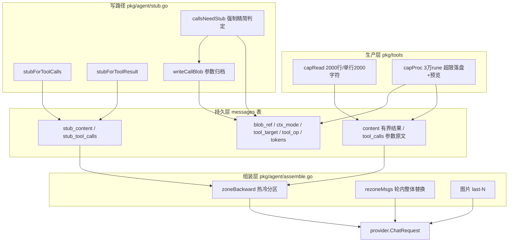

# 上下文组装治理技术规范 (Context Assembly Governance)

> **版本**：v1.1.0（原始参数持久化与强制 stub 回放）
> **所属阶段**：系统架构阶段七 (Phase 7) —— 上下文预算、长程记忆与压缩 · 前置模块  
> **核心组件**：工具层进场有界、写时 Stub 生成、messages 治理列、热/冷分区组装器、ReAct 轮内 Rezone、历史图片保留策略

---

## 1. 问题背景（本模块解决什么）

改造前，历史消息组装是**全量回放**，三类问题随会话长度恶化：

1. **写入类参数全量重放**：assistant 行的 `tool_calls` 携带完整 `write_file`/`edit_file` 参数（整文件内容），每轮请求原样重发；参数侧唯一的 40KB 上限只拦"执行"，不拦落库与上下文。
2. **工具结果无界**：bash/python 输出单条可达 256KB、read_file 可达 100KB，多次调用累积后一次请求即撑爆窗口；单轮 ReAct 撑爆后全量消息已落库，**重试下一轮继续爆，会话卡死**。
3. **历史图片全量重注入**：每张历史图片每轮重新磁盘读取 + base64 编码进多模态消息，token 与 CPU 双重浪费。

另有一个存量缺陷：`finish=length` 时被截断的**半截 JSON 参数**原样落库，下轮回放被上游 API 以 400 拒绝。

## 2. 核心设计模型

### 2.1 三档内容

每条消息的内容按"模型可见性"分三档：

| 档位 | 载体 | 进 LLM 上下文 | 说明 |
|---|---|---|---|
| **原文** | `tool_calls` 参数字符串及 `.tool-outputs/` 归档 | 参数仅在策略允许时进入；blob 不直接注入 | 模型生成参数完整落库，包含非法/截断原文；大参数与非法参数另行归档 |
| **content**（结果有界版） | `messages.content` | 热区 | 工具结果先按 capRead/capProc 等规则压界，再落库和进入上下文 |
| **stub**（精简版） | `stub_content` / `stub_tool_calls` | 冷区或强制 stub | 写时生成，额外存一份；>40KiB 或非法参数设置 `ctx_mode='stub'`，当前 Turn 与历史回放都立即使用 |

**口径按可再生性划分**：不可再生的数据（用户输入、模型生成的参数）全量落库；可再生的数据（read 的文件本在沙箱、bash 超限输出落盘、命令可重跑）落"有界口径 + 引用"。这是"可逆压缩"——载荷丢掉、指针留下，模型真需要时自己取回。

### 2.2 分区与 step

- **step = 一次上游 LLM 调用**：一条含 `tool_calls` 的 assistant 消息 + 其全部 tool 结果（含并行调用）。分区、计数均以 step 为粒度（与 Anthropic context editing 的 keep 粒度一致）。
- **热区**：最近若干 step，payload 行（工具参数与结果）保留 content 原文。双条件任一触顶，更旧行全部进冷区：① 距今 step 数 ≥ 该工具阈值（read:2 / write:1 / edit:1 / bash:3 / python:3 / 其它:8）；② 热区累计 token 超窗口 × 25%。
- **冷区**：stub 口径。
- **豁免（无视分区）**：`ctx_mode='stub'` 优先强制精简；其余 in-flight 最新 step 保留原文；user/system/纯文本 assistant（叙事）恒原文；已识别错误结果恒保留。

### 2.3 防线分工

| 防线 | 位置 | 管什么 |
|---|---|---|
| 工具层进场有界 | `pkg/tools` | 单条消息体积上限（治"一次调用就爆"） |
| 轮内 Rezone | ReAct 循环 round 边界 | 单 turn 内累积（治"一个回合累计爆"） |
| 分区组装 | `buildContext` | 跨 turn 历史存量（治"会话越用越贵"） |

## 3. 总体数据流拓扑

## 4. 设计原则（不变量）

1. **参数存储与回放分离**：`tool_calls` 完整保存原始参数；工具 `content` 按结果规则限长；大参数与非法参数只在模型回放中使用 stub；
2. **stub 是额外一份**：三处消费（落库生成、旧数据组装回退、轮内 rezone）共用同一批纯函数，同输入同输出（Go map 序列化按 key 排序，确定性成立，有测试钉住）；
3. **回放协议完整**：变换保持调用与结果配对、回放 arguments 为合法 JSON 对象字符串、id/type/name 不变；数据库允许保存非法 arguments 原文供审计；
4. **错误是证据**：失败结果在所有裁剪路径上保留原文；
5. **强制 stub 不影响原文**：在内存 append 时选择精简副本，历史组装与 rezone 同样遵守模式；执行只校验原始 JSON，合法大参数不因体积被拒绝；
6. **组装确定性 + 缓存友好**：同样的行 + 同样的策略 → 逐字节相同请求；分区边界粘性（触顶后更旧全部冷区）、rezone 批量一次后前缀只增不变；
7. **两把尺**：体积截断用 rune（字符）计数对齐 token 体量；token 估算用 `len/2`（字节）偏保守——中文密度高时宁可高估早裁。

## 5. 模块地图

| 文件 | 规范文档 | 内容 |
|---|---|---|
| `backend/pkg/tools/tools.go`（capRead/capProc/ArgsNeedStub） | [producer.md](producer.md) | 结果限长、参数解析与回放阈值 |
| `backend/pkg/agent/stub.go` | [producer.md](producer.md) | stub 规则、原始参数归档、extras 落库装配 |
| `backend/pkg/agent/agent.go`（buildContext / ReAct 循环） | [assemble.md](assemble.md) | 分区选择器、图片策略、rezone 接线 |
| `backend/pkg/agent/assemble.go` | [assemble.md](assemble.md) | zoneBackward / rezoneMsgs 分区核心 |
| `backend/pkg/ctxpolicy/` | [assemble.md](assemble.md) | 策略配置（叶子包，破导入环） |
| `backend/pkg/provider/context_window.go` | [assemble.md](assemble.md) | 模型窗口表 |
| `deploy/sql/schema.sql` + `migrations/20260921_messages_context_columns.sql` | [database.md](database.md) | 8 个治理列与幂等迁移 |

## 6. 关键场景速览

| 场景 | 处理 |
|---|---|
| 任意工具参数 >40KiB 且合法（含 MCP） | 原文完整落库、正常执行；`stub_tool_calls` 精简参数，`ctx_mode='stub'` 立即作用于当前 Turn 与历史；原始调用数组另行归档，摘要携带 `_source` |
| 非法 JSON / finish=length 半截 JSON | 原文完整落库；回放使用 `_rejected`；非法参数不进入工具执行，响应截断时结束整批，下轮由 flushDangling 补缺失结果 |
| read 结果大 | content = 前 2000 行 + 翻页提示（无 blob，文件本在沙箱）；stub = 摘要行 |
| bash/python 结果 >3万字符 | content = 头 8000 + 省略 + 尾 4000 + blob 路径；完整输出落 `.tool-outputs/`；错误结果豁免 |
| 历史图片 | 仅最近 2 张真实图，其余文本占位且不做 URL/base64 解析；当前轮全量 |
| 单轮累积超窗 | 上一轮实测 `prompt_tokens` > 窗口×0.65 → 内存 msgs 整体分区替换一次 |

## 7. 已知限制（v1.0.0）

1. 完整参数现在保存在 `tool_calls`，大行仍会影响数据库读取和前端历史体积；stub 只控制模型请求。已有数据中被旧版本替换掉的参数不会自动回填。
2. Loop Guard 提示前缀拼进 `out.Text` 后，`IsErrorResult` 可能识别不出被盖住前缀的错误（后果保守：错误走默认 stub 分支，不丢信息）。
3. 被拒调用的 tool 行折叠键为 NULL（参数原文不可解析，保守不折叠）。
4. blob 文件为 sanitize 后的清洗版（≤256KB），非进程原始字节。
5. blob 双写沙箱与对象存储（Bucket 空落本地 uploads/）；`blob_ref` 存 `{"path","url"}`，沙箱回收后 `materializeBlobs` 按需恢复。旧裸路径无 URL 时不能恢复，任一写入失败只告警。参数归档保存原始调用数组，进程输出归档则是 sanitize 后的版本。

## 8. 后续阶段（数据列已就绪）

- **LLM Compaction（阶段七·模块二）**：**已规划，完整设计见 [compaction.md](compaction.md)**——水位超 `窗口×0.70` 时 turn 前同步触发历史切分与滚动摘要（`session_digests` 表已建、`token_usages.purpose='compact'` 已预留、`sessions.last_context_tokens` 死列待激活），非破坏（messages 行永不删除）。实现按 compaction.md §14 的 C1/C2/C3 拆分执行。
- **冷区折叠**：连续同 `(tool_target, tool_op)` 的冷区记录合并为一条文本消息（如 `a.py：append ×10，共 800 行，全部成功`），失败保留次数与最后一条错误；批量折叠保缓存。折叠落地后 compaction 的输入升级为折叠口径（见 compaction.md §11）。
- **view_image 工具**：历史图片按需回看（占位符 + 沙箱路径已具备）。
- **前端"查看完整输出"**：工具卡片按 `blob_ref` 的归档 URL 直链完整输出（存储归档已就绪，纯前端工作）。
