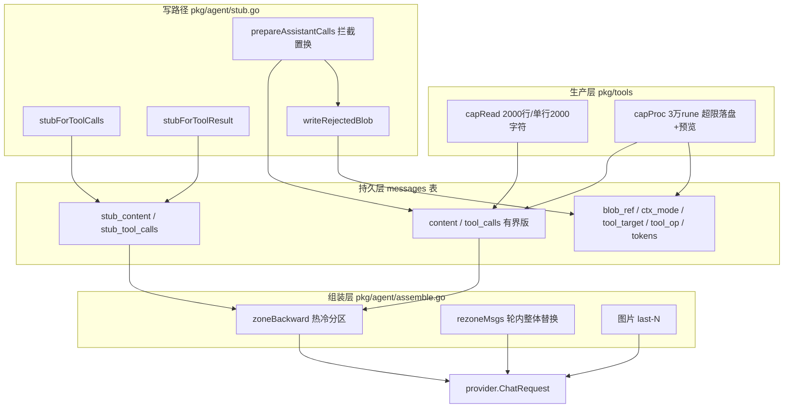

# 上下文组装治理技术规范 (Context Assembly Governance)

> **版本**：v1.0.0  
> **所属阶段**：系统架构阶段七 (Phase 7) —— 上下文预算、长程记忆与压缩 · 前置模块  
> **核心组件**：工具层进场有界、写时 Stub 生成、messages 治理列、热/冷分区组装器、ReAct 轮内 Rezone、历史图片保留策略

---

## 1. 问题背景（本模块解决什么）

改造前，历史消息组装是**全量回放**，三类问题随会话长度恶化：

1. **写入类参数全量重放**：assistant 行的 `tool_calls` 携带完整 `write_file`/`edit_file` 参数（整文件内容），每轮请求原样重发；参数侧唯一的 40KB 上限只拦"执行"，不拦落库与上下文。
2. **工具结果无界**：bash/python 输出单条可达 256KB、read_file 可达 100KB，多次调用累积后一次请求即撑爆窗口；单轮 ReAct 撑爆后全量消息已落库，**重试下一轮继续爆，会话卡死**。
3. **历史图片全量重注入**：每张历史图片每轮重新磁盘读取 + base64 编码进多模态消息，token 与 CPU 双重浪费。

另有一个存量缺陷：`finish=length` 时被截断的**半截 JSON 参数**原样落库，下轮回放被上游 API 以 400 拒绝。

## 2. 核心设计模型

### 2.1 三档内容

每条消息的内容按"模型可见性"分三档：

| 档位 | 载体 | 进 LLM 上下文 | 说明 |
|---|---|---|---|
| **原文** | blob 文件（沙箱 `.tool-outputs/`） | 永不 | 超限落盘的完整输出、被拒参数原文（审计） |
| **content**（有界版） | `messages.content` / `tool_calls` 列 | 热区 | 落库口径 = 发模型口径（同一份字符串）；进场时已被工具层压界 |
| **stub**（精简版） | `stub_content` / `stub_tool_calls` 列 | 冷区 | 写时用确定性规则生成，**额外存一份，不覆盖原文** |

**口径按可再生性划分**：不可再生的数据（用户输入、模型生成的参数）全量落库；可再生的数据（read 的文件本在沙箱、bash 超限输出落盘、命令可重跑）落"有界口径 + 引用"。这是"可逆压缩"——载荷丢掉、指针留下，模型真需要时自己取回。

### 2.2 分区与 step

- **step = 一次上游 LLM 调用**：一条含 `tool_calls` 的 assistant 消息 + 其全部 tool 结果（含并行调用）。分区、计数均以 step 为粒度（与 Anthropic context editing 的 keep 粒度一致）。
- **热区**：最近若干 step，payload 行（工具参数与结果）保留 content 原文。双条件任一触顶，更旧行全部进冷区：① 距今 step 数 ≥ 该工具阈值（read:2 / write:1 / edit:1 / bash:3 / python:3 / 其它:8）；② 热区累计 token 超窗口 × 25%。
- **冷区**：stub 口径。
- **豁免（无视分区）**：in-flight 最新 step 恒原文；user/system/纯文本 assistant（叙事）恒原文；错误结果 stub=原文恒保留；`ctx_mode='stub'`（被拦截）恒 stub。

### 2.3 防线分工

| 防线 | 位置 | 管什么 |
|---|---|---|
| 工具层进场有界 | `pkg/tools` | 单条消息体积上限（治"一次调用就爆"） |
| 轮内 Rezone | ReAct 循环 round 边界 | 单 turn 内累积（治"一个回合累计爆"） |
| 分区组装 | `buildContext` | 跨 turn 历史存量（治"会话越用越贵"） |

## 3. 总体数据流拓扑

## 4. 设计原则（不变量）

1. **content / tool_calls 列永远有界**：原文只存 blob 文件，永不进上下文、不进 SELECT * 大行；
2. **stub 是额外一份**：三处消费（落库生成、旧数据组装回退、轮内 rezone）共用同一批纯函数，同输入同输出（Go map 序列化按 key 排序，确定性成立，有测试钉住）；
3. **协议永真**：任何变换保持 tool_call/tool_result 按 `tool_call_id` 成对、arguments 恒为合法 JSON 字符串、id/type/name 结构不动；
4. **错误是证据**：失败结果在所有裁剪路径上保留原文；
5. **被拒参数原文永不进任何后续请求**：置换发生在落库与内存 append 之前；
6. **组装确定性 + 缓存友好**：同样的行 + 同样的策略 → 逐字节相同请求；分区边界粘性（触顶后更旧全部冷区）、rezone 批量一次后前缀只增不变；
7. **两把尺**：体积截断用 rune（字符）计数对齐 token 体量；token 估算用 `len/2`（字节）偏保守——中文密度高时宁可高估早裁。

## 5. 模块地图

| 文件 | 规范文档 | 内容 |
|---|---|---|
| `backend/pkg/tools/tools.go`（capRead/capProc/ArgsOverLimit） | [producer.md](producer.md) | 进场有界、超限落盘、截断模板 |
| `backend/pkg/agent/stub.go` | [producer.md](producer.md) | stub 规则、拦截路径、extras 落库装配 |
| `backend/pkg/agent/agent.go`（buildContext / ReAct 循环） | [assemble.md](assemble.md) | 分区选择器、图片策略、rezone 接线 |
| `backend/pkg/agent/assemble.go` | [assemble.md](assemble.md) | zoneBackward / rezoneMsgs 分区核心 |
| `backend/pkg/ctxpolicy/` | [assemble.md](assemble.md) | 策略配置（叶子包，破导入环） |
| `backend/pkg/provider/context_window.go` | [assemble.md](assemble.md) | 模型窗口表 |
| `deploy/sql/schema.sql` + `migrations/20260921_messages_context_columns.sql` | [database.md](database.md) | 8 个治理列与幂等迁移 |

## 6. 关键场景速览

| 场景 | 处理 |
|---|---|
| write 参数 >40KB | 落库/上下文均换 `_rejected` stub（path 保留），原文进 blob，`ctx_mode='stub'`；执行仍用原文 → `[参数超限]` 错误文本补 tool 行（带分块出路） |
| finish=length 半截 JSON | 同上置换成合法 JSON stub；下轮回放走 flushDangling 补 `[未执行]` |
| read 结果大 | content = 前 2000 行 + 翻页提示（无 blob，文件本在沙箱）；stub = 摘要行 |
| bash/python 结果 >3万字符 | content = 头 8000 + 省略 + 尾 4000 + blob 路径；完整输出落 `.tool-outputs/`；错误结果豁免 |
| 历史图片 | 仅最近 2 张真实图，其余文本占位且不做 URL/base64 解析；当前轮全量 |
| 单轮累积超窗 | 上一轮实测 `prompt_tokens` > 窗口×0.65 → 内存 msgs 整体分区替换一次 |

## 7. 已知限制（v1.0.0）

1. `rezoneMsgs` 内部分区预算当前用默认窗口（131072），未随 `session.Model` 传入——非默认窗口模型（如 1M 的 MiniMax）触发线与裁剪力度不一致。建议修法：函数加 model 参数从循环传入。
2. Loop Guard 提示前缀拼进 `out.Text` 后，`IsErrorResult` 可能识别不出被盖住前缀的错误（后果保守：错误走默认 stub 分支，不丢信息）。
3. 被拒调用的 tool 行折叠键为 NULL（参数原文不可解析，保守不折叠）。
4. blob 文件为 sanitize 后的清洗版（≤256KB），非进程原始字节。
5. ~~blob 生命周期跟随沙箱~~（v1.0.1 已解决）：超限输出与被拒参数原文现在**双写**——沙箱 `.tool-outputs/`（模型当场可读）+ 对象存储归档（`storage.PutArchive`，Bucket 空自动落本地 uploads/），`blob_ref` 列存 `{"path","url"}` JSON。沙箱回收后 `materializeBlobs` 每轮按需重物化（文件还在则零流量跳过，与 `materializeAttachments` 同款生命周期兜底）。v1.0.0 的裸路径行兼容读取但无从恢复。残余限制：重物化的存在性检查在 docker/e2b 驱动下是一次远程读（本地驱动是廉价 os 调用）；归档为 sanitize 后的清洗版。

## 8. 后续阶段（数据列已就绪）

- **冷区折叠**：连续同 `(tool_target, tool_op)` 的冷区记录合并为一条文本消息（如 `a.py：append ×10，共 800 行，全部成功`），失败保留次数与最后一条错误；批量折叠保缓存。
- **LLM Compaction（阶段七·模块二）**：`session_digests` 表已建、`token_usages.purpose='compact'` 已预留，对最老段做摘要。
- **view_image 工具**：历史图片按需回看（占位符 + 沙箱路径已具备）。
- **前端"查看完整输出"**：工具卡片按 `blob_ref` 的归档 URL 直链完整输出（存储归档已就绪，纯前端工作）。
