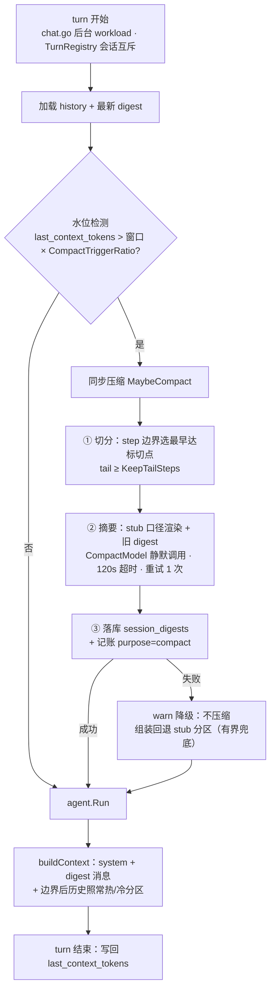

# 智能压缩流水线规范 (Compaction Flow)

> **版本**：v1.0.0（规划稿——实现另起一轮，按 §14 的 PR 拆分执行）  
> 所属模块：[上下文组装治理](./README.md) · 第三层防线  
> 已确认决策：**turn 前同步触发**、**独立低档摘要模型**（默认 `GLM-5.3-Flash`，可配）  
> 数据基座：`session_digests` 表（已建零 DDL）、`sessions.last_context_tokens`（现成死列，本模块激活）、`token_usages.purpose='compact'`（计费规范已预留）

---

## 1. 定位与分层

上下文治理的三层防线，**便宜的、可逆的手段永远排在贵的、不可逆的手段前面**：

| 层 | 机制 | 成本 | 可逆性 | 状态 |
|---|---|---|---|---|
| 一 | 工具层进场有界 + 热/冷分区 + stub | 零 token、常驻 | 完全可逆（原文在 DB/blob） | **已实现** |
| 二 | 冷区折叠（同目标操作合并） | 零 token、规则聚合 | 轻度有损 | 列已就绪，逻辑待做 |
| 三 | **compaction 摘要（本规范）** | 一次 LLM 调用 | **不可逆**（请求侧；DB 原文永存） | **本规范** |

关键耦合：**水位衡量的是分区/stub 之后仍超**——`last_context_tokens` 记录的是真实发出的请求体积（已含冷区 stub 化），compaction 只在前两层尽力之后仍溢出时才触发。这保证最贵的一层用得最少。

## 2. 前沿参考对照（每家取一点、避一点）

| 参考 | 取 | 避 |
|---|---|---|
| **Claude Code** | 自然停顿点触发（= 我们的 turn 边界）；保留清单：system + 摘要 + 最近消息 + 任务状态 | 社区批评的"无法关闭、不可检查"→ 我们配 `CompactEnabled` 开关、摘要落库可查询 |
| **Codex CLI** | 专用压缩 prompt、客户端本地执行（非 Codex 模型同款路径） | "压缩后无法回看历史" → 我们非破坏：DB 行永不删除，前端历史全量 |
| **Pi (badlogic)** | 压缩指令可定制（`CompactInstructions`）；"尽量不压缩优先"哲学 | — |
| **ZCode** | 透明摘要：摘要 + 未压缩的近期上下文原样续接，模型无感切换 | — |
| **Anthropic 服务端 compaction** | 仅作协议演进参考；我们走 OpenAI 兼容端点，全客户端实现 | — |

## 3. 流水线总览



## 4. 触发机制

- **水位定义**：`sessions.last_context_tokens`——现有死列，由 `agent.Run` 在 turn 结束时写回**最后一轮实测 `prompt_tokens`**（`dao.UpdateSessionContextTokens`，`WithoutCancel`）。它反映分区/stub 生效后真实请求体积，是"前两层用尽"的准确信号。列值为 0（新会话/旧数据）时回退 `estimateTokens(history)`。
- **阈值**：`CompactTriggerRatio = 0.70`（根 README 既定）；切分目标 `CompactTargetRatio = 0.40`——触发线与目标线构成迟滞带，压缩一次后水位落到 40% 以下，需要再积累 30% 窗口才会再触发，杜绝抖动。
- **时序**：**turn 前同步**（已确认）——挂在 `chat.go` 后台 workload 里 `agent.Run` 之前：`history` 与 `digest` 加载后、Run 调用前执行 `MaybeCompact(ctx, session, history, digest)`。用户已发出的消息**不在压缩范围**（它属于当前活动任务）。
- **开关**：`CompactEnabled=false` 或 `CompactTriggerRatio=0` 即整体关闭（Claude Code "无法关闭"批评的反面）。
- **并发**：TurnRegistry 的会话互斥天然保证同一会话不会并发压缩；无 digest 行写入竞态。
- **代价说明**：同步压缩在触发轮增加首字延迟数秒（一次 Flash 档调用）；§15 记录"按实测切 turn 后异步"为演进项。

## 5. 历史切分（Cut Point 选择）

- **边界规则**：只在 **step 边界**切——含 `tool_calls` 的 assistant 行 + 其全部配对 tool 结果为一个 step（与分区组装同一分组语义），绝不把配对拆进摘要/tail 两侧；切点必然使 `flushDangling` 在两侧各自为空操作（协议安全）。
- **切点选择——最小必要前缀原则**：从早到晚扫描候选切点，取**最早**满足 `digest 估算 + tail ≤ 窗口 × CompactTargetRatio` 的切点（摘要掉最少的历史即达标，减少摘要链 churn、保留尽量多原文）。
- **下限保护**：tail 至少保留 `KeepTailSteps = 12` 个 step（与热区 `DefaultHotSteps=8` 留出余量）——即使更早切就能达标，也不允许 tail 少于该值。
- **范围闭包**：`digest.UptoMessageID < 切点 ≤ history 末行`；当前轮用户消息未入 history，天然排除。

## 6. 摘要生成

### 6.1 输入（天然有界）

待压缩段以 **stub 口径**渲染（复用分区冷区渲染：`stub_tool_calls`/`stub_content` 列，旧数据现场生成）——每次调用的体积从千字节降到百字节级，摘要输入不需要再设计截断。输入 = 旧 digest（若有）+ 段内 stub 渲染；若仍超输入上限（约 5 万 token），最老的 stub 再预折叠为单行 `[已折叠: tool ×N]` 标记。

### 6.2 Prompt 模板（全文，`CompactInstructions` 为可配置尾部）

```text
你是会话历史压缩器。下面是一次长对话中的【旧摘要】（此前压缩的结果，可能为空）与
【待压缩的历史消息段】（工具载荷已精简为 stub 口径）。请把二者合并蒸馏成一份新的
会话摘要，供同一会话的后续对话无缝继续使用。

要求：
1. 只依据给定材料，绝不编造；不确定的内容宁可不写。
2. 必须保留：文件路径、关键命令、数字结论（行数/字节数/退出码/耗时）、错误信息要点、
   用户的明确偏好与纠正、未完成事项。
3. 按以下固定分段输出 Markdown（无内容的段落省略）：
   ## 任务意图与约束 —— 用户要什么、不可违反的约束
   ## 已完成事项与关键决策 —— 做成了什么、为什么这么做
   ## 涉及文件与现状 —— 「路径 → 当前状态」一行一条（创建/修改/导出/失败）
   ## 错误与未解决尝试 —— 什么路走不通、报了什么错
   ## 用户偏好与纠正 —— 沟通风格、命名与技术选型的明确要求
   ## 待办与下一步 —— 尚未完成、正在进行的事
4. 总长不超过 {DigestMaxTokens} token；优先保路径与结论，压缩过程叙述。

{CompactInstructions}

【旧摘要】
{old_digest}

【待压缩历史段】
{segment_stub_view}
```

### 6.3 调用机制

- 模型：`ctxpolicy.CompactModel`（默认 `GLM-5.3-Flash`，空串回退 `session.Model`），`provider.GetProviderForModel` 解析（registry 前缀匹配自动生效）。
- 通道：复用 `StreamChat` 静默消费（无 emit、不进 SSE）——provider 包当前无非流式接口，消费 channel 与 `streamOneRound` 同款模式；120s 超时，失败重试 1 次。
- 产出约束：`len(digest)/2 ≤ DigestMaxTokens`（2048），超长则截尾并告警（防御性，prompt 已约束长度）。

### 6.4 失败降级

摘要调用最终失败 → `slog.Warn` + 放弃本轮压缩（不落 digest 行）→ 组装回退到现有 stub 分区（冷区有界兜底）→ 对话照常进行。**压缩永远不阻塞、不断送对话**；下一轮水位仍超则自然重试。

## 7. 滚动摘要链

```
第 n 次压缩：digest_n = Summarize( digest_{n-1}, segment(upto_{n-1}, cut_n) )
```

- 旧行**永久保留**在 `session_digests`（审计轨迹、摘要质量回溯）；组装只用 `upto_message_id` 最大的一行。
- 单滚动摘要保证上下文体积有界；远期信息衰减（超长会话的早期细节逐轮稀释）记入 §15 开放问题，备选方案为分段摘要链（多行 digest 按时序拼接，保真更好但体积渐增）。

## 8. 组装集成（buildContext）

- 签名：`buildContext(ctx, session, history, digest *model.SessionDigest)`——**保持纯函数可测**：digest 由 chat.go workload 加载后传入（与 history 同源），buildContext 自身零 DB 访问。
- 渲染规则：
  1. 跳过 `history` 中 `ID ≤ digest.UptoMessageID` 的行（被摘要覆盖，不再进请求）；
  2. system 消息之后注入一条 **user 角色**的带框摘要消息（OpenAI 兼容协议下 mid-conversation system 不通用，user 承载最稳）：

```text
[会话历史摘要（系统自动压缩，覆盖此前的对话；原文完整保留在会话记录中）]

{digest.content}
```

  3. digest 消息**豁免分区**（它本身就是压缩产物，自带 `DigestMaxTokens` 上界）；
  4. 边界之后的历史照常走热/冷分区、图片 last-2、悬空修复——两层机制正交叠加。
- 兼容：`digest == nil`（未压缩会话/测试）时行为与现状逐字节一致。

## 9. 数据与记账（对齐 specs/token_usage/billing.md §5 强制约定）

| 项 | 约定 |
|---|---|
| `session_digests` 写入 | `session_id / upto_message_id(=切点行ID) / content / covered_tokens(段内 tokens_full 之和) / covered_messages`；新增 `dao/session_digests.go`：`CreateSessionDigest` / `GetLatestSessionDigest(sessionID)`（按 upto_message_id 取最大） |
| `sessions.last_context_tokens` | turn 末写回最后一轮 `usage.PromptTokens`（激活死列；水位 + 观测双重用途） |
| `token_usages` | purpose=`compact`、**round=0**、**model=压缩档模型**——`recordTokenUsage` 从 session 结构取 model，用**浅拷贝 session 副本替换 Model 字段**实现归属正确；`WithoutCancel`（客户端断连不丢账）、失败仅 warn、nil usage 不记账——逐条复用现有旁路记账入口，禁止直插 |

## 10. 配置（ctxpolicy 扩展，零值合并）

| 键 | 默认 | 说明 |
|---|---|---|
| `CompactEnabled` | true | 一键关闭 |
| `CompactTriggerRatio` | 0.70 | 触发水位（窗口占比） |
| `CompactTargetRatio` | 0.40 | 切分目标水位（迟滞带下沿） |
| `CompactModel` | "GLM-5.3-Flash" | 摘要模型；空回退会话模型 |
| `DigestMaxTokens` | 2048 | 摘要体积上限 |
| `KeepTailSteps` | 12 | 切点后最少保留 step 数 |
| `CompactInstructions` | "" | 附加压缩指令（Pi 式可定制） |

同步 `etc/config.yaml` 与 `etc/config.local.yaml` 的 `AgentPolicy` 段（local 是整体替换语义，必须双边同步——v1.0.1 的教训）。

## 11. 与既有模块的交互

| 模块 | 关系 |
|---|---|
| 热/冷分区 | digest 消息豁免分区；边界后历史照常分区——正交叠加 |
| 轮内 rezone（0.65） | 先于 compaction（0.70）动作：轮内压力由 rezone 消化，跨 turn 存量才轮到摘要 |
| stub 规则 | 摘要输入消费 stub 口径——三层机制复用同一套渲染 |
| 冷区折叠（未实现） | 折叠落地后，摘要输入升级为折叠口径（更省）；`tool_target/tool_op` 列已备 |
| blob 归档/重物化 | 无交互（digest 只覆盖消息行，blob 生命周期独立） |
| 计费/用量统计 | purpose=compact 独立分账，成本可观测（Flash 档单价 × 压缩次数） |

## 12. 非破坏性保证

1. `messages` 行**永不删除**——被摘要覆盖的行只是不进请求，DB 与前端历史全量在；
2. `session_digests` 只追加——摘要链全程可审计；
3. 理论可回退：删除 digest 行（或把组装切回旧行）即回到未压缩视图，为将来的 rewind 类功能留门。

## 13. 测试基线

- **纯函数**（无 DB）：切分边界（step 不拆散、KeepTailSteps 下限、最小前缀选择）、水位判定与迟滞、digest 渲染注入与边界过滤、`digest=nil` 兼容。
- **fakeProvider 驱动**：摘要调用参数（model/消息形状/prompt 段落）、成功落库、失败降级（不落行、不阻塞）、滚动链（二次压缩吃旧 digest）。
- **集成**（真实 MySQL）：触发→digest 落库→buildContext 组装体积下降、边界前行被跳过、配对完整、`token_usages` 记 model=CompactModel、`last_context_tokens` 写回。

## 14. PR 拆分与实施顺序

| PR | 内容 |
|---|---|
| **C1 数据与配置** | `dao/session_digests.go`、`UpdateSessionContextTokens`、ctxpolicy 七个新键 + yaml 双边同步、单测 |
| **C2 压缩核心** | `pkg/agent/compact.go`：切分选择、prompt 组装、StreamChat 静默消费、digest 落库、compact 记账（session 副本）、失败降级；纯函数 + fakeProvider 单测 |
| **C3 接线与集成** | chat.go workload 触发（`MaybeCompact`）、`buildContext` digest 参数与注入、Run 末写回水位、集成测试 |

依赖关系：C1 → C2 → C3 串行；C2 的切分/渲染可先行开发（纯函数）。

## 15. 风险与开放问题

| 项 | 说明 | 对策 |
|---|---|---|
| 同步首字延迟 | 触发轮多等一次 Flash 调用（数秒） | 上线后按实测评估切"turn 后异步 + 下轮兜底同步"（演进项，接口按 MaybeCompact 封装、两种时机可换） |
| 摘要质量依赖 prompt | 丢关键路径/结论会导致模型重读文件（成本回吐） | 固定分段模板 + `CompactInstructions` 可定制；`session_digests` 留档可人工抽查迭代 |
| 滚动摘要远期衰减 | 超长会话早期细节逐轮稀释 | 分段摘要链备选（体积换保真）；配合折叠层减少衰减面 |
| in-turn 中途压缩缺失 | 单 turn 32 轮内水位冲过 0.85+ 的极端场景无摘要兜底 | phase 2：循环内在 0.85 档触发同款 MaybeCompact（msgs 就地替换为 digest+tail） |
| 触发判定滞后一轮 | `last_context_tokens` 是上一轮实测 | turn 前以 history 估算二次校验（取 max），成本 O(n) 字节求和 |
