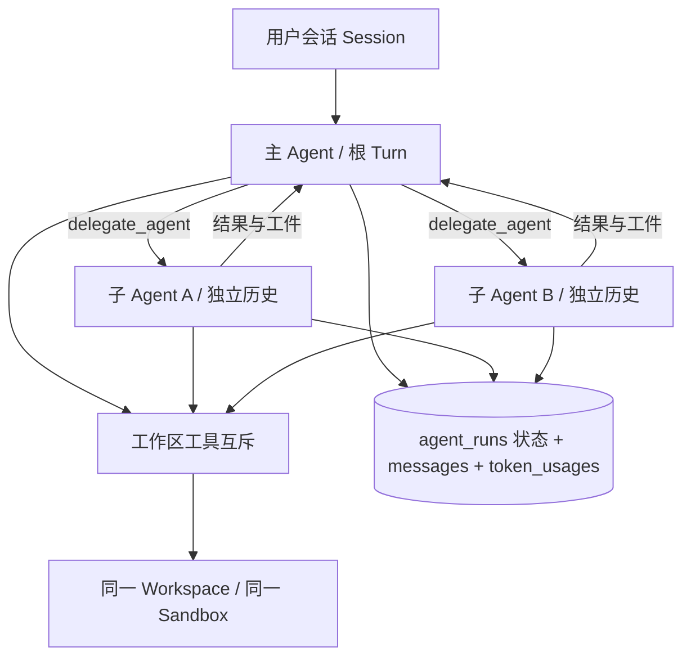

# 多 Agent 设计与实现

日期：2026-10-23。本文为本项目的实现契约；产品资料与出处另见 [research.md](research.md)。

## 1. 核心决策

采用 **主 Agent 编排 + 有界并行子 Agent + 持久化任务状态**。LLM 上下文彼此隔离，文件工作区共享，结果由工具返回父 Agent。Orchestration 与共享状态不是二选一：前者决定谁分工、谁汇总，后者记录任务进度、结果和共同文件；不把所有 Agent 的消息拼进同一个可变数组。

`session_id` 继续代表用户会话、租户授权和费用归属；新增 `agent_runs` 记录每次子 Agent 的身份、父子关系和运行状态；`messages`、`token_usages` 增加 `agent_id`。旧数据及主 Agent 使用空 `agent_id`，无需复制旧历史。协议中的主 Agent ID 使用 `session_id`，子 Agent 使用独立 UUID。

**Agent ≠ sandbox。** 本期 `workspace_id = 根 session_id`。所有子 Agent 使用根会话现有 sandbox，创建 Agent 不调用新 sandbox 创建接口。无需立即新增 workspace 表；只有将来支持一个会话多个工作区、分支或跨会话资源租约时再独立建表。

## 2. 当前代码与改造边界

当前 `pkg/agent/agent.go` 的 `session.SessionID` 同时用于消息、工具、技能与附件；`TurnRegistry` 按会话互斥，SSE 只是订阅者。保留该结构，消息归属通过显式执行 Context 中的 AgentID 传递，Session 仍始终是根会话实体。DAO 默认查询主 Agent 历史；子 Agent API 必须先校验根会话权限，再切换 AgentID 查询。

首版交付：一个主 Agent 可在同一工具轮中调用多个 `delegate_agent`，每个子任务有独立 ReAct 循环、持久消息、结果卡片与状态；刷新后可恢复查看；父取消级联取消；服务重启将未终结子任务标记 interrupted。根会话、技能/MCP权限及用量接口保持兼容。

本期不实现无限递归、跨服务分布式调度、自动重放有副作用的任务、Agent 私聊/广播总线、工作树自动合并。它们是明确的后续能力，不作为本次基础版本已经实现的功能。

## 3. 数据模型

| 实体 | 标识与作用 | 生命周期 |
| --- | --- | --- |
| sessions | session_id；用户可见根对话、owner/company、模型配置 | 用户创建/删除 |
| agent_runs | agent_id、session_id、parent_agent_id、workspace_id、tool_call_id | 一次委派任务 |
| messages | session_id + agent_id；主/子互不混入历史 | 随会话持久化 |
| token_usages | session_id + agent_id；全部计入根会话账单 | 保留审计 |
| sandbox | workspace_id；现有 Driver 的资源键 | 根会话拥有，子完成不释放 |

`agent_runs` 还包含 name/task/mode/model/status/result/error/created_at/started_at/finished_at。`(session_id, tool_call_id)` 唯一，阻止同一已落库工具调用重复创建执行记录。默认不重试已失败或状态不明确的副作用任务；父 Agent 应使用新调用明确发起新任务。

消息索引 `(session_id, agent_id, id)` 支持历史顺序读取。主 API 的消息定位、计数和截断同样必须带 AgentID，避免拿子消息 ID 编辑根历史。删除会话在执行线程完全退出后删除所有 Agent 消息和关系，再关闭唯一根 sandbox。Token 审计行不随聊天删除而隐式清除。

增量 SQL 单独存放于 `deploy/sql/migrations`，不对现有数据库执行含 DROP 的全量 schema。GORM GEN 按实际库重新生成；启动不悄悄修改已有表。

## 4. 委派协议与上下文

工具 `delegate_agent` 参数：`name`（简短角色名）、`task`（自包含任务与验收条件）、`mode`（read_only 默认，或 write）。模型沿用父模型；本期不允许客户端传入其他租户、任意 workspace、额外凭证或升级能力。

父 Agent 的工具调用与结果照常存入主历史。子 Agent 从独立任务文本开始，不隐式复制父完整消息历史；必要信息由父任务明确传入，共同附件和文件已在根工作区。子 Agent 继承根系统约束及已准备的技能/MCP能力，不能扩大授权范围。read_only 只提供 `read_file`，禁止 shell/Python/MCP 等能绕过只读约束的工具；write 可使用已授权的工作区工具与父已启用 MCP。子 Agent 禁止再次委派、动态装载技能和直接 `request_input`，需要用户决定时返回父 Agent。

子任务返回结构化 agent_id/status/result/error/attachments，父 Agent 负责检验、整合并对用户交付。成功状态只表示执行循环正常结束，不等于结果已经由父 Agent 验证正确。

## 5. 并发、文件与生命周期

每个根 turn 最多同时运行 3 个子 Agent，累计最多 12 个；子 Agent 最多 16 次模型调用且总时限 5 分钟。排队等待也继承父 Context；限额由后端强制，不能靠提示词约定。子 Agent 不走会创建 Background Context 的独立 TurnRegistry.Start。

模型调用可以并行。共享工作区工具经同一可取消互斥执行，避免同一时刻 read/modify/write 工具互相覆盖。任意 shell/Python 具有不透明副作用，也进入互斥。互斥只保证单次工具的原子访问，不保证跨调用的读取快照；父 Agent 应按文件划分写任务，遇到同文件复杂改动串行委派并复查。未来可以添加文件版本 compare-and-swap 或同一 sandbox 内 Git worktree；worktree 不等于新容器。

根完成前必须等待所有同步委派收束。子 panic、Provider 错误、截断、轮数上限均记为 failed；根取消或子超时终止执行并写终态。特别是现有 run 可在 emit(error) 后 return nil，因此状态判断必须同时观察错误事件。子任务不会关闭 sandbox。用户删除根会话需先取消并等待，防止 WithoutCancel 落库在删除后重新写入孤儿消息。

内置工具取消后 join 实际执行 goroutine，之后才能释放工作区锁。Docker/E2B 命令由 Python3 监督独立进程组，带服务端 UUID、启动门、进程组登记和取消标记；取消时通过独立清理调用确认本次进程组退出，不销毁兄弟共享的 sandbox。无法确认清理时工作区进入隔离状态，后续文件/命令操作被拒绝，需显式销毁或新建会话；不会自动重放不确定是否已执行的命令。

该监督机制覆盖普通前台及继承进程组的后台子进程，**不保证清除主动使用 setsid / start_new_session 脱离进程组的全部后代**，也不是不可信代码的完整隔离。共享 workspace 的 write 模式属于同一信任域；需要强进程树/恶意代码边界时应使用独立 sandbox、每执行 cgroup 等更强机制。MCP 远端副作用同样受服务自身取消语义限制，不能承诺远端事务回滚。

根执行持有工作区租约，Docker 巡检跳过活跃和隔离工作区；巡检与冷启动互斥，销毁失败保留句柄。E2B 服务端硬 TTL 不受本地租约控制，本期没有实现云端 TTL 自动续期。

状态机：`queued → running → completed|failed|cancelled`；队列取消可直接 `queued → cancelled`；进程重启把 queued/running 改为 interrupted，保留已有输出，不自动恢复外部副作用。当前与 TurnRegistry 一样仅支持单实例运行；多实例上线前必须增加 worker 租约、owner/heartbeat、持久队列和事件通道，不能在每个实例启动时全局中断别人的任务。

## 6. 事件、API 与界面

根 SSE 保持原 done/error/delta 语义；子事件只能通过独立 `agent_status` / `agent_event` 外层事件发送，带 agent_id、parent_agent_id、session_id、workspace_id。子 done/error 不能结束根流，子 delta 不能追加到主助手正文。仍复用根 stream_id/seq 重连补播。

为避免并行子任务的逐 token 输出挤掉根环形缓冲中的工具事件，子 delta/round_progress 不广播到根 SSE；子完整内容通过持久历史查询，根只接收子生命周期及工具边界事件。事件缓冲仍是有限窗口，跨服务重启依赖数据库快照，不承诺无限事件回放。

增加 `GET /api/sessions/:id/agents` 和 `GET /api/sessions/:id/agents/:agent_id`（记录及隔离历史），先执行根会话读权限校验。执行入口仍是主 Agent 委派工具，停止仍使用现有根 stop API，不添加任意外部 spawn 接口。前端显示任务名、只读/可写、状态、结果/错误，刷新通过列表恢复。

会话用量查询天然聚合主/子，因为 SessionID 不变；每行 AgentID 可审计。主流中的 token 水位仍属于主模型上下文，不能把各 Agent 的上下文水位相加当作单一窗口。子费用以会话总用量接口为准。

重新生成/编辑根历史只截断主消息；旧 Agent 记录作为审计保留，按原 tool_call_id 关联，不能把旧结果自动注入新 turn。新的委派必须用新调用 ID；旧终态结果的幂等读取须先验证所属 session。

## 7. 验收与发布

必须验证：独立历史且同一 workspace；父子权限继承；read_only 对伪造写工具的运行时拒绝；并发与累计上限；取消排队及执行中 child；子失败不结束父流；error+nil 不误标成功；重启 interrupted；跨租户访问拒绝；会话删除无迟到写入；根账单包含子用量；前端构建与 SSE 测试。

实施顺序：数据库迁移/身份隔离 → runtime委派/取消/限额 → API/SSE/界面 → 确定性 fake Provider 集成测试 → 本机启动及 HTTP 验证。最终测试命令、实际结果与尚存限制记录于 [validation.md](validation.md)。

## 8. 后续演进条件

| 实际需求 | 应增加的机制 | 仍保持的边界 |
| --- | --- | --- |
| 同一个子 Agent 多次接续 | agent 实体与 agent_run/attempt 分离，显式 resume 与消息邮箱 | 每个 Agent 独立历史、根授权 |
| 多层任务拆分 | max_depth、全树并发/预算、祖先取消、父等待不占执行槽 | workspace 继承根资源键 |
| 长任务/DAG/多机 | 持久 tasks、依赖边、租约与 heartbeat、条件认领、事件 outbox | 数据库事实源，禁止自动重放未知副作用 |
| 同文件并行分支 | 同一 sandbox 内 worktree、版本检查、显式整合和冲突处理 | worktree 与 sandbox 是不同资源 |
| 跨租户/不同凭据/不可信代码 | 独立 sandbox 与网络/凭据策略，显式资源绑定 | 不因父子关系跨越授权边界 |

这些条件发生前不引入通用共享黑板、无限 Agent 图或分布式调度框架。当前实现利用已有 ReAct、DAO、TurnRegistry 和 sandbox Driver，新增内容围绕可验证的委派能力。
