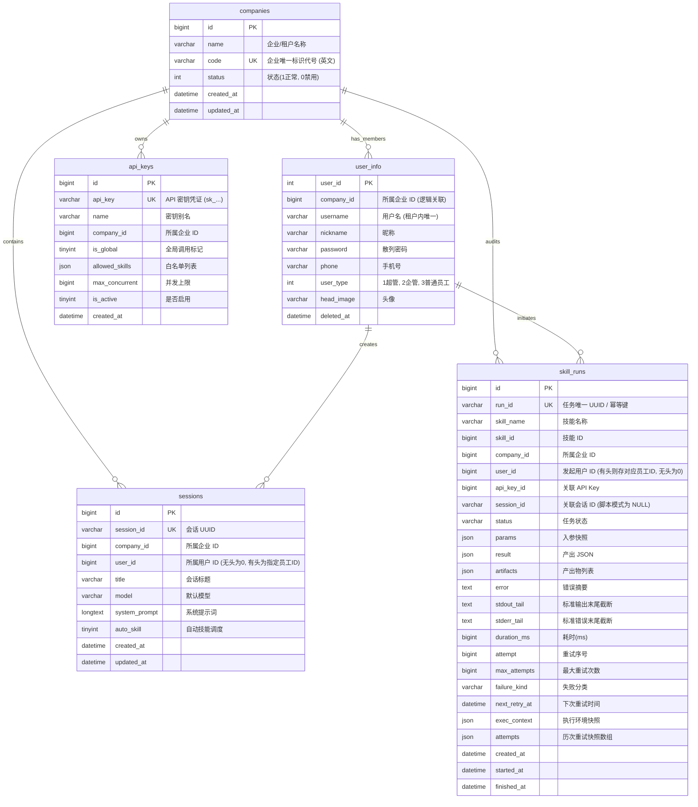
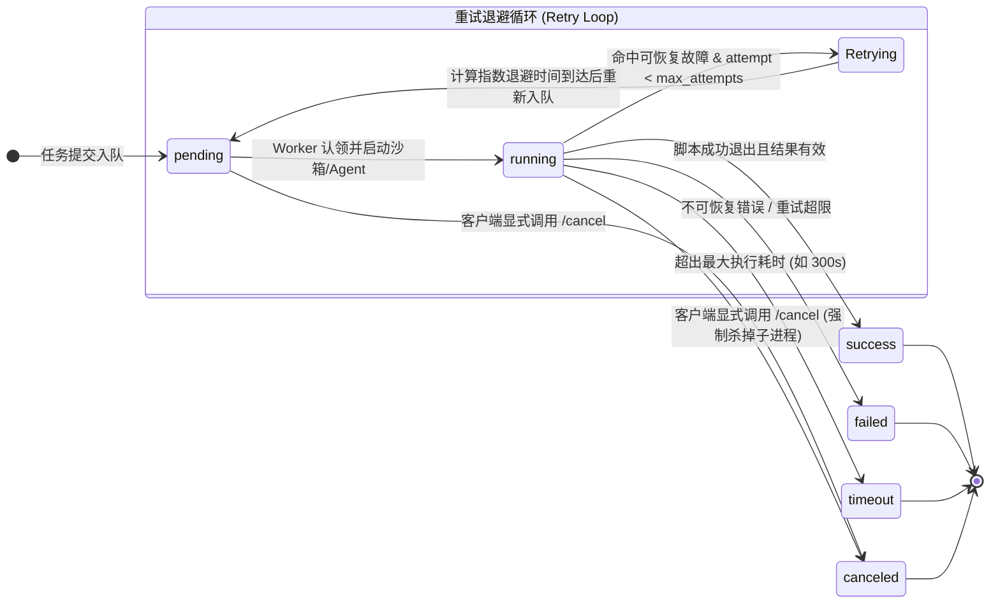

# 开放 API 与任务调度数据库模型规范 (Database Specification)

> **版本**：v1.1.0  
> **数据库引擎**：MySQL 8.0+ / InnoDB / `utf8mb4`  
> **ORM 映射**：GORM Gen ([`backend/dal/model/`](../../backend/dal/model/))  
> **实体定义**：[`company.go`](../../backend/dal/model/company.go)、[`user_info.gen.go`](../../backend/dal/model/user_info.gen.go)、[`api_keys.gen.go`](../../backend/dal/model/api_keys.gen.go)、[`skill_runs.gen.go`](../../backend/dal/model/skill_runs.gen.go)

---

## 1. 实体关系总览 (Entity Relationship)



---

## 2. 表结构详细定义

### 2.1 企业/租户表 `companies`

#### DDL 结构
```sql
CREATE TABLE `companies` (
  `id` BIGINT NOT NULL AUTO_INCREMENT COMMENT '企业主键 ID',
  `name` VARCHAR(128) NOT NULL COMMENT '企业/租户名称 (如: 智慧医疗科技中心)',
  `code` VARCHAR(64) NOT NULL COMMENT '企业全局唯一英文字符标识/代号 (如: default, corp_alpha)',
  `status` INT NOT NULL DEFAULT '1' COMMENT '状态：1 正常，0 禁用',
  `created_at` DATETIME(3) NOT NULL DEFAULT CURRENT_TIMESTAMP(3) COMMENT '创建时间',
  `updated_at` DATETIME(3) NOT NULL DEFAULT CURRENT_TIMESTAMP(3) ON UPDATE CURRENT_TIMESTAMP(3) COMMENT '更新时间',
  PRIMARY KEY (`id`),
  UNIQUE KEY `idx_companies_code` (`code`)
) ENGINE=InnoDB DEFAULT CHARSET=utf8mb4 COLLATE=utf8mb4_unicode_ci COMMENT='企业与多租户基础表';
```

#### 设计要点
- 系统预置 `id=1, code='default', name='默认企业'` 作为单租户或未指定企业时的平滑兼容兜底。
- 多租户场景下，用户登录可通过 `company_code` 精确定位所属租户。

---

### 2.2 用户表 `user_info`（支持跨企同名）

#### DDL 结构
```sql
CREATE TABLE `user_info` (
  `user_id` INT NOT NULL AUTO_INCREMENT COMMENT '用户主键 ID',
  `company_id` BIGINT NOT NULL DEFAULT '1' COMMENT '所属企业 ID (逻辑关联 companies.id)',
  `username` VARCHAR(64) COLLATE utf8mb4_unicode_ci NOT NULL COMMENT '用户名',
  `nickname` VARCHAR(64) COLLATE utf8mb4_unicode_ci NOT NULL DEFAULT '' COMMENT '昵称',
  `password` VARCHAR(255) COLLATE utf8mb4_unicode_ci NOT NULL COMMENT '密码哈希',
  `phone` VARCHAR(32) COLLATE utf8mb4_unicode_ci NOT NULL DEFAULT '' COMMENT '手机号码',
  `user_type` INT NOT NULL DEFAULT '3' COMMENT '用户类型：1：超级管理员，2：管理员(企管)，3：普通用户(员工)',
  `head_image` VARCHAR(512) COLLATE utf8mb4_unicode_ci NOT NULL DEFAULT '' COMMENT '用户头像',
  `created_at` DATETIME(3) NOT NULL DEFAULT CURRENT_TIMESTAMP(3) COMMENT '创建时间',
  `updated_at` DATETIME(3) NOT NULL DEFAULT CURRENT_TIMESTAMP(3) ON UPDATE CURRENT_TIMESTAMP(3) COMMENT '更新时间',
  `deleted_at` DATETIME(3) DEFAULT NULL COMMENT '软删除时间',
  PRIMARY KEY (`user_id`),
  UNIQUE KEY `idx_company_username` (`company_id`, `username`),
  KEY `idx_user_info_company_id` (`company_id`)
) ENGINE=InnoDB DEFAULT CHARSET=utf8mb4 COLLATE=utf8mb4_unicode_ci COMMENT='用户信息与权限分配表';
```

#### 关键约束升级
- **跨企重名支持**：索引从全局单一 `username` 改为联合唯一索引 `UNIQUE KEY (company_id, username)`。不同企业的员工可使用相同账号（如 `admin`、`zhangsan`），同企业内保持唯一。
- **三级角色权限分配**：
  - `user_type = 1 (SuperManager)`：平台超级管理员，跨所有租户查看和管理全局数据；
  - `user_type = 2 (Manager)`：企业管理员，仅管理所属 `company_id` 内的员工、会话、API Key 和运行记录；
  - `user_type = 3 (User)`：普通员工，仅查看和管理属于自己的 `user_id` 的会话。

---

### 2.3 API 密钥表 `api_keys`

#### DDL 结构
```sql
CREATE TABLE `api_keys` (
  `id` BIGINT NOT NULL AUTO_INCREMENT COMMENT '密钥主键 ID',
  `api_key` VARCHAR(128) NOT NULL COMMENT '系统签发的 API 密钥 (唯一凭据，例如 sk_live_xxxxxxxx)',
  `name` VARCHAR(64) NOT NULL DEFAULT '' COMMENT '密钥备注名称 (如: 生产环境CI节点、数据中台管道)',
  `company_id` BIGINT NOT NULL DEFAULT '0' COMMENT '所属企业/租户 ID (实现严格的多租户数据隔离)',
  `is_global` TINYINT(1) NOT NULL DEFAULT '0' COMMENT '是否拥有全局技能调用权限 (1: 允许调用全库技能; 0: 遵循 allowed_skills 白名单)',
  `allowed_skills` JSON DEFAULT NULL COMMENT '允许调用的技能名称数组 (JSON 格式，例如 ["web-search", "data-cleaner"])',
  `max_concurrent` BIGINT NOT NULL DEFAULT '3' COMMENT '该 Key 允许的最大并发执行任务上限 (超限返回 429)',
  `is_active` TINYINT(1) NOT NULL DEFAULT '1' COMMENT '密钥激活状态 (1: 正常; 0: 已停用/撤销)',
  `created_at` DATETIME(3) NOT NULL DEFAULT CURRENT_TIMESTAMP(3) COMMENT '创建时间',
  PRIMARY KEY (`id`),
  UNIQUE KEY `idx_api_keys_key` (`api_key`),
  KEY `idx_api_keys_company_id` (`company_id`)
) ENGINE=InnoDB DEFAULT CHARSET=utf8mb4 COLLATE=utf8mb4_unicode_ci COMMENT='开放 API 密钥与权限配额表';
```

---

### 2.4 任务执行记录表 `skill_runs`

#### DDL 结构
```sql
CREATE TABLE `skill_runs` (
  `id` BIGINT NOT NULL AUTO_INCREMENT COMMENT '任务主键 ID',
  `run_id` VARCHAR(36) NOT NULL COMMENT '单次执行唯一 UUID (由服务端生成或客户端传入 Idempotency Key)',
  `skill_name` VARCHAR(128) NOT NULL COMMENT '目标技能名称',
  `skill_id` BIGINT DEFAULT NULL COMMENT '目标技能 ID (关联 skills.id)',
  `company_id` BIGINT NOT NULL DEFAULT '0' COMMENT '所属企业 ID',
  `user_id` BIGINT NOT NULL DEFAULT '0' COMMENT '发起调用用户 ID (有头模式为指定员工 ID，无头模式为 0)',
  `api_key_id` BIGINT DEFAULT NULL COMMENT '调用的 API Key ID (NULL 代表来自 Web 控制台手动触发或重试)',
  `session_id` VARCHAR(36) DEFAULT NULL COMMENT '关联的会话 ID (纯脚本模式为 NULL，LLM模式写入关联会话)',
  `status` VARCHAR(20) NOT NULL COMMENT '任务状态: pending / running / success / failed / timeout / canceled',
  `params` JSON DEFAULT NULL COMMENT '输入参数结构化快照 (JSON)',
  `result` JSON DEFAULT NULL COMMENT '最终产出结构化结果 (JSON)',
  `artifacts` JSON DEFAULT NULL COMMENT '产出文件/工件列表 (例如 [{"name": "report.pdf", "url": "..."}])',
  `progress` JSON DEFAULT NULL COMMENT '任务进度或里程碑日志数组',
  `error` TEXT DEFAULT NULL COMMENT '错误概要描述',
  `stdout_tail` TEXT DEFAULT NULL COMMENT '脚本/Agent 标准输出末尾截断 (用于现场排查)',
  `stderr_tail` TEXT DEFAULT NULL COMMENT '脚本/Agent 标准错误末尾截断 (用于现场排查)',
  `duration_ms` BIGINT DEFAULT NULL COMMENT '总执行耗时 (毫秒)',
  `attempt` BIGINT NOT NULL DEFAULT '1' COMMENT '当前执行尝试序号 (从 1 开始递增)',
  `max_attempts` BIGINT NOT NULL DEFAULT '1' COMMENT '最大允许尝试次数 (由客户端指定或系统默认，上限 5)',
  `failure_kind` VARCHAR(32) DEFAULT NULL COMMENT '失败归类: sandbox / timeout / script_error / llm_error / param_invalid / rate_limited / network_error',
  `next_retry_at` DATETIME(3) DEFAULT NULL COMMENT '下次计划重试执行的时间 (指数退避计算所得)',
  `exec_context` JSON DEFAULT NULL COMMENT '运行时环境快照 (沙箱驱动类型、模型选择等)',
  `attempts` JSON DEFAULT NULL COMMENT '前序各次重试的历史快照数组 (JSON Array)',
  `created_at` DATETIME(3) NOT NULL DEFAULT CURRENT_TIMESTAMP(3) COMMENT '创建时间',
  `started_at` DATETIME(3) DEFAULT NULL COMMENT '开始执行时间',
  `finished_at` DATETIME(3) DEFAULT NULL COMMENT '终态结束时间',
  PRIMARY KEY (`id`),
  UNIQUE KEY `idx_skill_runs_run_id` (`run_id`),
  KEY `idx_skill_runs_status` (`status`),
  KEY `idx_skill_runs_created_at` (`created_at`),
  KEY `idx_skill_runs_api_key_id` (`api_key_id`),
  KEY `idx_skill_runs_session_id` (`session_id`),
  KEY `idx_skill_runs_skill_name` (`skill_name`),
  KEY `idx_skill_runs_skill_id` (`skill_id`),
  KEY `idx_skill_runs_company_id` (`company_id`),
  KEY `idx_skill_runs_user_id` (`user_id`)
) ENGINE=InnoDB DEFAULT CHARSET=utf8mb4 COLLATE=utf8mb4_unicode_ci COMMENT='技能任务执行历史与审计日志表';
```

---

## 3. 三类运行模式与数据落库机制（纯脚本 vs 无头 vs 有头）

在多租户与开放 API 调用时，系统严格区分为以下三种工作模式：

| 维度 | 纯脚本模式 (`mode=script`) | 大模型无头模式 (`mode=llm, user_id=0`) | 大模型有头模式 (`mode=llm, user_id>0`) |
| :--- | :--- | :--- | :--- |
| **是否调用 LLM** | 否 | 是 | 是 |
| **沙箱工作模式** | 瞬态沙箱，执行脚本完成后退出 | 关联临时会话沙箱，随 15 分钟空闲回收 | 关联用户真实会话沙箱，随 15 分钟空闲回收 |
| **`sessions` 记录** | **不生成** (`session_id = NULL`) | **生成** (`user_id = 0, company_id = Key.CompanyID`) | **生成** (`user_id = 指定员工ID, company_id = Key.CompanyID`) |
| **`messages` 记录** | 不生成 | 写入（系统提问、工具调用、模型回答） | 写入（系统提问、工具调用、模型回答） |
| **普通员工可见性** | 网页端不可见 | 网页端不可见（不在员工会话列表） | **员工端直接可见**（出现在“我的对话”列表，可继续交互） |
| **企业管理员可见性** | 在 `skill_runs` 列表中查看审计 | 在 `skill_runs` 及“企业全部会话”中查看详情 | 在 `skill_runs` 及“企业全部会话”中查看详情 |
| **写入与交互权限** | 无会话，无需交互 | 仅企业管理员 (2) 或合法 API Key 拥有追加写入权限 | 员工本人 (3)、企业管理员 (2) 或 API Key 均有写入权限 |

---

## 4. 任务状态机与生命周期流转 (Run State Machine)



### 4.1 故障归类与可重试判定

| 故障类别 (`failure_kind`) | 是否属于可恢复重试 (Retryable) | 触发典型场景 |
| :--- | :--- | :--- |
| `param_invalid` | **否** | 输入参数不符合 `parameters` 的 JSON-Schema 声明，直接拒绝。 |
| `script_error` | **否** | 脚本自身抛出语法错误、ImportError 或业务 Logic Error（退出码非 0）。 |
| `network_error` | **是** | 脚本执行中访问外部网络瞬时超时、DNS 丢包或沙箱网络抖动。 |
| `sandbox` | **是** | 沙箱容器瞬时拉起失败、挂载异常、Docker 守护进程抖动。 |
| `rate_limited` | **是** | 调用大模型遇到上游 429 Too Many Requests 限流。 |
| `timeout` | **视情况** | 首次超时可根据策略决定是否重试一次，默认不可重试。 |
