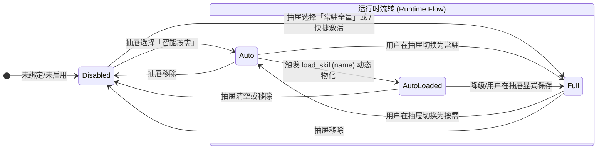
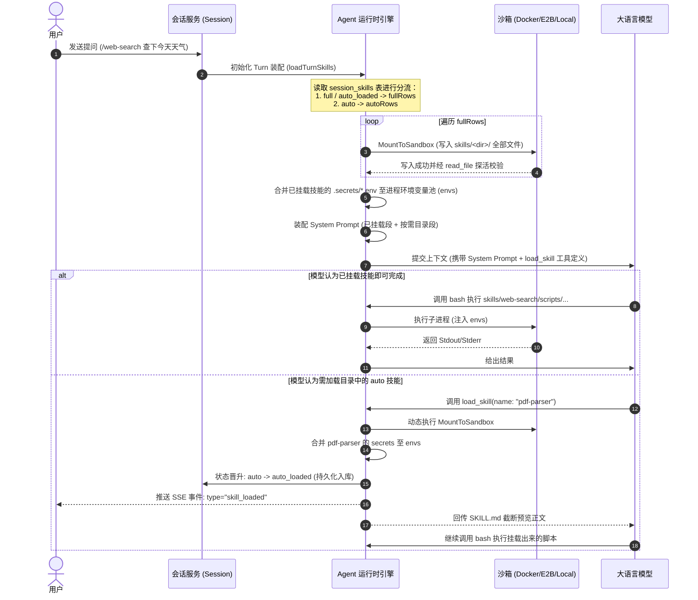

# Skill 模块系统规范文档 (Skill Specification)

> **版本**：v1.2.0  
> **状态**：Active / Production  
> **适用范围**：AI Agent 后端引擎、前端交互工作台、沙箱环境及数据持久层  

---

## 1. 模块概述与核心设计理念

Skill（技能）模块是平台赋予大语言模型（LLM）调用外部专业工具、领域知识与复杂脚本的核心扩展机制。通过标准化的目录结构、声明式入口与沙箱隔离执行，LLM 能够根据对话意图自主装载并运行各种专用工具。

### 1.1 核心设计理念

1. **文件系统作为唯一真相源（File-first Source of Truth）**  
   每个 Skill 物理对应平台存储根目录 `skills/<dir_name>/` 下的一个独立子目录。必须包含入口声明文件 `SKILL.md`（YAML frontmatter 元数据 + Markdown 使用指引）。数据库中的注册表（`skills`）是文件系统的索引与权限投影，支持实时双向扫描与同步。

2. **严格隔离的机密管理（Secrets Segregation）**  
   任何 API 密钥、数据库凭据或环境变量一律隔离存放在 `.secrets/<dir_name>.env` 中，**绝对不会物理挂载进沙箱工作区**（防止模型利用 `cat` / `read_file` 泄露凭证）。仅在技能装载时，由后端在宿主侧解析并经进程环境变量（`tools.WithEnv`）注入执行子进程。

3. **瞬态沙箱物化（Ephemeral Sandbox Materialization）**  
   沙箱工作区采用瞬态挂载策略，每次轮次（Turn）开始前，已启用的技能文件（脚本、配置等）全量写入沙箱工作区的 `skills/<dir_name>/` 目录下，与附件物化保持同等生命周期。

4. **渐进式意图分流与按需装载（Two-tier Prompting & On-demand Loading）**  
   为了避免将数十个 Skill 的完整说明一次性塞入上下文导致 Token 爆炸或模型注意力分散，系统实施两级分类机制：
   - **已挂载（Full / Auto-Loaded）**：Prompt 注入完整路径指引，沙箱已就绪，模型直接调用脚本。
   - **未挂载（Auto 目录条目）**：Prompt 仅注入 160 字简短用途摘要，沙箱未就绪；模型若需使用，必须先调用 `load_skill` 工具触发动态物化。

---

## 2. 技能包标准目录规范

一个合规的 Skill 目录物理结构如下：

```text
skills/
├── <dir_name>/
│   ├── SKILL.md                 # [必需] 入口声明文件 (YAML Frontmatter + Markdown)
│   ├── manifest.json            # [可选/开放API推荐] 对外 API 契约声明文件 (命令模板/入参Schema/产物抽取)
│   ├── scripts/                 # [推荐] 可执行脚本目录 (Python / Shell / Node.js)
│   │   ├── main.py
│   │   └── helper.sh
│   ├── references/              # [可选] 领域静态文档 / 模式定义
│   └── templates/               # [可选] 模版文件
└── .secrets/                    # [受保护] 机密环境变量目录 (不对外暴露)
    └── <dir_name>.env           # 键值对机密 (如 BRAVE_API_KEY=xxx)
```

### 2.1 SKILL.md 格式规范

```markdown
---
name: web-search
description: 用于进行互联网搜索并提取结构化网页内容的高精度搜索工具，适用于需要最新资讯或外部事实核查的场景。
tags: [search, web, tool]
parameters:                      # 可选，供开放 API 任务驱动入参定义
  query:
    type: string
    description: 搜索关键词
---

# Web Search 使用指引

当需要调用搜索时，请使用 `bash` 或 `python_exec` 工具执行如下命令：
`python skills/web-search/scripts/search.py --query "<关键词>"`

环境变量 `BRAVE_API_KEY` 已自动注入进程环境中，无需手动传递。
```

### 2.2 manifest.json 对外 API 执行契约规范

当 Skill 需要对外通过开放 API（`POST /api/v1/skill-runs`）调用时，推荐在技能根目录下提供 `manifest.json`，实现**零代码改动接入、安全参数注入与产物解耦抽取**：

```json
{
  "api_enabled": true,
  "version": "1.0",
  "description": "抓取目标网页并输出纯净的正文或 Markdown 内容",
  "command": "python skills/{dir}/scripts/fetch.py --workdir {workdir} {url}",
  "stdin": "params_json",
  "timeout_sec": 30,
  "default_mode": "sync",
  "input_schema": {
    "type": "object",
    "required": ["url"],
    "properties": {
      "url": { "type": "string", "description": "需要抓取的目标页面 URL" },
      "timeout": { "type": "integer", "default": 10, "description": "超时秒数" }
    }
  },
  "result_extractors": [
    {
      "name": "data",
      "type": "regex_stdout",
      "pattern": "\\[API_RESULT_BEGIN\\]\\s*(.+?)\\s*\\[API_RESULT_END\\]",
      "group": 1,
      "dotall": true,
      "as_json": true
    },
    {
      "name": "report",
      "type": "file",
      "path": "{workdir}/*.xlsx",
      "upload": true
    }
  ],
  "llm_enabled": false,
  "llm_prompt_template": "请执行技能 {skill_name}，参数为：{params_json}",
  "retry": {
    "max_attempts": 3,
    "on": ["sandbox", "timeout", "script_error"],
    "backoff_sec": 10
  }
}
```

#### 核心字段释义：
- **`api_enabled`** (`bool`)：硬门槛。若为 `false`，开放 API 网关直接拦截拒绝调用（返回 400）。
- **`command`** (`string`)：沙箱执行命令模板。支持 `{dir}`, `{workdir}`, `{run_id}` 及入参占位符（如 `{url}`）。
- **`stdin`** (`string`)：`"params_json" | "none"`。若为 `"params_json"`，runner 将调用方 `params` 自动落盘至 `{workdir}/input.json` 并通过标准输入管道 `< input.json` 喂给脚本，杜绝 Shell 转义与注入漏洞。
- **`input_schema`** (`object`)：标准 JSON-Schema。在网关层执行入参强校验，缺必填项直接拦截。
- **`result_extractors`** (`array`)：日志与结果解耦抽取器：
  - `regex_stdout`：正则抓取标准输出中的结构化段落（如被 `[API_RESULT_BEGIN]...[API_RESULT_END]` 包裹的内容），支持 `as_json: true` 自动反序列化；
  - `file`：从沙箱工作区抽取文件产物，支持 `upload: true` 自动上传至对象存储并回填公开 URL。
- **`llm_prompt_template`** (`string`)：大模型模式下的定制化 Prompt 模板，支持替换 `{params_json}`, `{skill_name}`, `{workdir}`。

---

## 3. 三态生命周期与状态机模型

在会话关联层面（`session_skills` 表中的 `source` 字段），系统已全面废弃历史过渡态（`manual` 与 `catalog`），严格确立清晰的 **三态模型**：



### 3.1 状态定义

| 状态值 (`source`) | 显示名称 | 释义与装配行为 | 沙箱物化时机 | 系统提示词 (Prompt) 表现 |
| :--- | :--- | :--- | :--- | :--- |
| `full` | **常驻全量** | 用户在抽屉显式指定或通过 `/xxx` 语法快捷激活的技能。 | 对话 Turn 开始前**预先同步全量挂载**至 `skills/<dir>/` | 进入 `## 可用 Skills（已挂载）`，带具体调用路径与入口 |
| `auto` | **智能按需** | 用户选入或开启 `auto_skill` 后作为意图识别的候选技能。 | 初始**不挂载**沙箱 | 进入 `## Skill 目录（按需加载）`，描述截断至 160 字，暴露 `load_skill` 工具 |
| `auto_loaded` | **动态已装载** | 原本为 `auto` 状态，在对话中被模型主动调用 `load_skill` 激活物化的技能。 | 调用 `load_skill` 工具时**实时物化落盘** | 本轮实时注入 SKILL.md；后续轮次等同于 `full` 预先全量挂载 |

---

## 4. 核心工作流与协作流转

### 4.1 对话开轮装配流（Turn Initialization）



### 4.2 为什么必须区分 `load_skill` 与实际执行工具？

- **`load_skill` 本质是「物化加载与正文查阅工具」**：其职责是将技能文件从宿主安全复制到当前沙箱，并将该技能的机密注入运行时上下文，最后向模型呈现《使用手册》（`SKILL.md`）。
- **真正的工作负载由通用工具承载**：如 `bash`（运行 shell/python 脚本）、`python_exec` 或 `read_file`。模型看完手册后，自主决定调用脚本的具体命令行参数。

### 4.3 多技能协作机制（Multi-Skill Pipeline）

用户可单轮指定多个技能，例如发送：
```text
/stock-query /data-visualizer 分析苹果公司近三年财报并绘制折线图
```
前端与后端会自动将 `stock-query` 和 `data-visualizer` 均解析并激活为 `full` 状态：
1. 沙箱工作区会同时就绪 `skills/stock-query/` 与 `skills/data-visualizer/`。
2. 双边机密（如股票行情 API Key、图表渲染配置）无缝合并至进程环境。
3. 模型可依次调用两者的脚本，完成串联协作管线。

### 4.4 输入框 `/` 快捷调用规范（严格会话隔离）

- 输入框中输入 `/` 触发的快速调用浮层，**严格且仅展示当前会话已启用（常驻全量 full、智能按需 auto、已装载 auto_loaded）的技能**。
- 若会话未启用任何技能（抽屉中全为“关”），输入 `/` 浮层提示：“当前会话未启用任何技能（可在右上角 Skills 面板中启用）”，绝不越界展示未启用的全库技能。
- 浮层中对技能的当前会话状态（常驻、按需、已装载）进行小徽章（Badge）标记，直观反映当前装配策略。

---

## 5. 文档导航与索引

详细设计与实现细节已拆分为以下各专属技术规范文档，请参阅：

- [数据模型与数据库字段规范 (database.md)](./database.md)  
  包含 `skills`、`skill_versions`、`session_skills`、`skill_runs` 及 `sessions.auto_skill` 的详细 DDL、字段说明、索引及约束。
- [接口契约与 API 规范 (api.md)](./api.md)  
  包含技能增删改查、在线文件树编辑、Zip 打包上传下载、机密读写、会话状态绑定及 SSE 流式协议。
- [运行时装配与沙箱规范 (runtime.md)](./runtime.md)  
  包含 Turn 级装配逻辑、沙箱安全限制（文件数/容量）、防竞态回读探活、提示词装配算法及 `load_skill` 拦截器机制。
