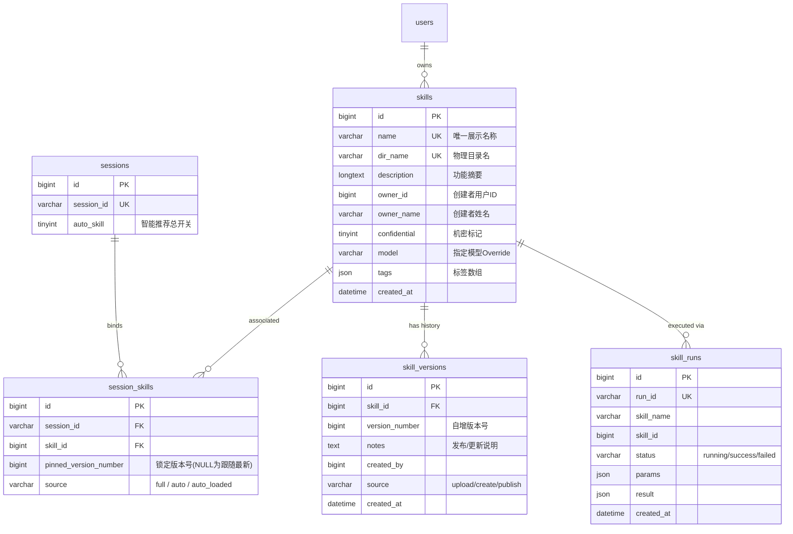

# Skill 数据库模型与字段规范 (Database Specification)

> **版本**：v1.2.0  
> **数据库引擎**：MySQL 8.0+ / InnoDB / `utf8mb4`  
> **ORM 映射**：GORM Gen ([`backend/dal/model/`](../../backend/dal/model/))

---

## 1. 数据架构总览 (Entity Relationship)



---

## 2. 表结构详细规范

### 2.1 技能主表 `skills`

记录技能在平台的注册信息与元数据投影。技能的唯一真实文件存储于磁盘 `skills/<dir_name>`，本表用于会话检索、权限判定与列表展示。

#### DDL 定义
```sql
CREATE TABLE `skills` (
  `id` BIGINT NOT NULL AUTO_INCREMENT COMMENT '技能主键 ID',
  `name` VARCHAR(128) NOT NULL COMMENT '技能全局唯一显示名称 (与 SKILL.md frontmatter name 一致)',
  `description` LONGTEXT NOT NULL COMMENT '技能用途功能摘要描述 (用于 Catalog 提示词生成)',
  `dir_name` VARCHAR(128) NOT NULL COMMENT '物理存储目录名 (小写规范化)',
  `owner_id` BIGINT NOT NULL DEFAULT 0 COMMENT '技能所有者 User ID (0 代表系统内置公共技能)',
  `owner_name` VARCHAR(64) NOT NULL DEFAULT '' COMMENT '所有者姓名/昵称',
  `confidential` TINYINT(1) NOT NULL DEFAULT 0 COMMENT '是否为机密技能 (0: 公开可用; 1: 仅所有者可查看代码与下载)',
  `model` VARCHAR(128) DEFAULT NULL COMMENT '指定运行该技能的特定模型覆盖',
  `tags` JSON DEFAULT NULL COMMENT '标签列表，以 JSON 字符串数组存储，例如 ["search", "tools"]',
  `created_at` DATETIME(3) NOT NULL DEFAULT CURRENT_TIMESTAMP(3) COMMENT '创建时间',
  PRIMARY KEY (`id`),
  UNIQUE KEY `idx_skills_name` (`name`),
  UNIQUE KEY `idx_skills_dir_name` (`dir_name`),
  KEY `idx_skills_owner_id` (`owner_id`)
) ENGINE=InnoDB DEFAULT CHARSET=utf8mb4 COLLATE=utf8mb4_unicode_ci COMMENT='技能基础注册表';
```

#### 字段详解
- **`id`** (`BIGINT`, PK, Auto-Increment)：技能全局标识符。
- **`name`** (`VARCHAR(128)`, NOT NULL, UNIQUE)：技能显示名称，必须与 `SKILL.md` 中的 `name` 严格保持一致。
- **`dir_name`** (`VARCHAR(128)`, NOT NULL, UNIQUE)：物理目录名，经 `SanitizeDirName` 处理（仅保留小写字母、数字、下划线与中划线），沙箱挂载路径即为 `skills/<dir_name>/`。
- **`owner_id`** (`BIGINT`, NOT NULL)：若为 0，代表系统初始化内置技能（网页端不可随意删除或覆盖）；非 0 时代表创建该技能的用户 ID。
- **`confidential`** (`TINYINT(1)`, NOT NULL)：
  - `0`（公开）：系统内所有登录用户均可在会话中选用、查看其文件与正文。
  - `1`（机密）：所有用户均可**使用**，但**只有所有者**可以进入文件编辑器查看源码、下载 Zip 包或查阅机密键值。
- **`tags`** (`JSON`, Nullable)：存储标准化后的标签列表（最多 8 个，每个字符上限 16），如 `["dev", "utility"]`。

---

### 2.2 技能版本历史表 `skill_versions`

跟踪技能的上传、创建与迭代发布历史。

#### DDL 定义
```sql
CREATE TABLE `skill_versions` (
  `id` BIGINT NOT NULL AUTO_INCREMENT COMMENT '版本记录主键 ID',
  `skill_id` BIGINT NOT NULL COMMENT '所属技能 ID (关联 skills.id)',
  `version_number` BIGINT NOT NULL COMMENT '版本序列号 (从 1 递增)',
  `notes` TEXT NOT NULL COMMENT '当前版本改动说明与日志',
  `created_by` BIGINT NOT NULL COMMENT '提交人 User ID',
  `created_by_name` VARCHAR(64) NOT NULL COMMENT '提交人姓名',
  `source` VARCHAR(16) NOT NULL DEFAULT 'publish' COMMENT '版本来源: upload (Zip上传), create (在线新建), publish (版本发布)',
  `created_at` DATETIME(3) NOT NULL DEFAULT CURRENT_TIMESTAMP(3) COMMENT '创建时间',
  PRIMARY KEY (`id`),
  KEY `idx_skill_versions_skill_id` (`skill_id`),
  KEY `idx_skill_versions_created_at` (`created_at`)
) ENGINE=InnoDB DEFAULT CHARSET=utf8mb4 COLLATE=utf8mb4_unicode_ci COMMENT='技能版本历史记录表';
```

#### 关键机制
- **工作副本即当前激活版本**：当前最小闭环架构中，磁盘工作副本即为实时生效版本。版本列表第一条（按 `version_number` 倒序）标记为 `is_current = true`。

---

### 2.3 会话与技能关联表 `session_skills`

核心绑定关系表，定义某一具体会话当前启用了哪些技能，以及这些技能各自的加载策略。

#### DDL 定义
```sql
CREATE TABLE `session_skills` (
  `id` BIGINT NOT NULL AUTO_INCREMENT COMMENT '主键 ID',
  `session_id` VARCHAR(36) NOT NULL COMMENT '会话 UUID (关联 sessions.session_id)',
  `skill_id` BIGINT NOT NULL COMMENT '关联技能 ID (关联 skills.id)',
  `pinned_version_number` BIGINT DEFAULT NULL COMMENT '锁定的版本号 (NULL 表示跟随当前最新版本)',
  `source` VARCHAR(16) NOT NULL DEFAULT 'full' COMMENT '装配类型: full (常驻全量), auto (智能按需), auto_loaded (动态已装载)',
  PRIMARY KEY (`id`),
  UNIQUE KEY `uk_session_skill` (`session_id`, `skill_id`),
  KEY `idx_session_skills_session_id` (`session_id`),
  KEY `idx_session_skills_skill_id` (`skill_id`)
) ENGINE=InnoDB DEFAULT CHARSET=utf8mb4 COLLATE=utf8mb4_unicode_ci COMMENT='会话技能绑定关系表';
```

#### `source` 字段演进与三态取值规范
在系统迭代中，历史过渡字段 `manual` 与 `catalog` 已被彻底弃用并完成全量数据清洗：
1. **`full` (常驻全量)**：
   - 产生场景：用户在右侧技能抽屉中勾选「常驻全量」，或者在输入框通过 `/skill-name` 语法发起提问。
   - 行为：每轮对话启动前，后端自动执行全量文件挂载到沙箱，并合并注入环境变量；System Prompt 注入完整挂载说明。
2. **`auto` (智能按需)**：
   - 产生场景：用户在技能抽屉中指定勾选为「智能按需」。
   - 行为：初始不挂载沙箱；仅作为候选进入 System Prompt 目录段（160 字截断），并暴露 `load_skill` 工具供 LLM 自主决定加载。
3. **`auto_loaded` (动态已装载)**：
   - 产生场景：模型在对话中命中意图，成功调用 `load_skill` 工具后，系统自动执行晋升持久化：
     ```sql
     INSERT INTO session_skills (session_id, skill_id, source)
     VALUES (?, ?, 'auto_loaded')
     ON DUPLICATE KEY UPDATE source = 'auto_loaded';
     ```
   - 行为：当轮动态物化挂载并合并环境变量；后续轮次中，等同于 `full` 处理，预先完成挂载。

---

### 2.4 会话主表扩展字段 `sessions.auto_skill`

会话表中关于技能自主调度的控制字段。

#### DDL 节选
```sql
ALTER TABLE `sessions` 
  ADD COLUMN `auto_skill` TINYINT(1) NOT NULL DEFAULT 1 COMMENT '是否开启技能智能按需感知 (1: 开启 Catalog 推荐; 0: 关闭，仅用常驻全量技能)';
```

- **`auto_skill = 1`（默认开启）**：
  - 会话允许智能按需加载能力。系统将 `session_skills` 中用户显式勾选为 `source = 'auto'` 的技能装配为 Catalog 候选集；
  - 若 `session_skills` 中未配置任何 `source = 'auto'` 技能，则 Catalog 为空，系统不会越权将全库技能自动推入，保持干净简洁。
- **`auto_skill = 0`（总开关关闭）**：
  - 彻底停用按需加载机制。即使 `session_skills` 中存在 `auto` 记录，也一律不装配 Catalog 候选集，不向 System Prompt 注入目录段，且完全**隐藏** `load_skill` 工具调用定义。会话仅运行 `full` 或此前已装载的技能。

---

### 2.5 技能独立执行流水表 `skill_runs`

用于独立 API 任务调用或异步自动化作业的执行日志与审计（阶段六扩展）。

#### DDL 定义
```sql
CREATE TABLE `skill_runs` (
  `id` BIGINT NOT NULL AUTO_INCREMENT COMMENT '主键 ID',
  `run_id` VARCHAR(36) NOT NULL COMMENT '单次执行唯一 UUID',
  `skill_name` VARCHAR(128) NOT NULL COMMENT '调用的技能名称',
  `skill_id` BIGINT DEFAULT NULL COMMENT '技能 ID',
  `company_id` BIGINT NOT NULL COMMENT '所属企业 ID',
  `user_id` BIGINT NOT NULL COMMENT '发起用户 ID',
  `api_key_id` BIGINT DEFAULT NULL COMMENT '使用的 API Key ID (若为外部调用)',
  `session_id` VARCHAR(36) DEFAULT NULL COMMENT '关联合话 ID (可选)',
  `status` VARCHAR(20) NOT NULL COMMENT '状态: pending / running / success / failed / timeout',
  `params` JSON DEFAULT NULL COMMENT '入参快照 (JSON 格式)',
  `result` JSON DEFAULT NULL COMMENT '最终产出结果 (JSON 格式)',
  `artifacts` JSON DEFAULT NULL COMMENT '产出物文件列表 (URL/路径)',
  `progress` JSON DEFAULT NULL COMMENT '执行进度快照',
  `error` TEXT DEFAULT NULL COMMENT '错误信息或栈追踪',
  `stdout_tail` TEXT DEFAULT NULL COMMENT '控制台标准输出末尾截断',
  `stderr_tail` TEXT DEFAULT NULL COMMENT '控制台标准错误末尾截断',
  `duration_ms` BIGINT DEFAULT NULL COMMENT '执行耗时 (毫秒)',
  `attempt` BIGINT NOT NULL DEFAULT 1 COMMENT '当前重试次数',
  `max_attempts` BIGINT NOT NULL DEFAULT 1 COMMENT '最大允许重试次数',
  `failure_kind` VARCHAR(32) DEFAULT NULL COMMENT '失败归类 (oom, timeout, script_error 等)',
  `next_retry_at` DATETIME(3) DEFAULT NULL COMMENT '预计下次重试时间',
  `exec_context` JSON DEFAULT NULL COMMENT '执行上下文环境参数',
  `attempts` JSON DEFAULT NULL COMMENT '多次重试明细记录',
  `created_at` DATETIME(3) NOT NULL DEFAULT CURRENT_TIMESTAMP(3) COMMENT '创建时间',
  `started_at` DATETIME(3) DEFAULT NULL COMMENT '开始执行时间',
  `finished_at` DATETIME(3) DEFAULT NULL COMMENT '完成时间',
  PRIMARY KEY (`id`),
  UNIQUE KEY `idx_skill_runs_run_id` (`run_id`),
  KEY `idx_skill_runs_skill_name` (`skill_name`),
  KEY `idx_skill_runs_skill_id` (`skill_id`),
  KEY `idx_skill_runs_company_id` (`company_id`),
  KEY `idx_skill_runs_user_id` (`user_id`),
  KEY `idx_skill_runs_status` (`status`),
  KEY `idx_skill_runs_created_at` (`created_at`)
) ENGINE=InnoDB DEFAULT CHARSET=utf8mb4 COLLATE=utf8mb4_unicode_ci COMMENT='技能任务执行历史与审计日志表';
```

---

## 3. 数据库迁移与数据兼容记录 (Migration History)

### 3.1 废弃 `manual` 全量迁移至 `full`
- **执行时间**：2026-09-18
- **执行范围**：开发与测试数据库 (`127.0.0.1:3306`) 及预生产/生产数据库 (`43.138.247.132:3306`)
- **迁移语句**：
  ```sql
  -- 1. 将所有存量历史数据更新为 'full'
  UPDATE `session_skills` SET `source` = 'full' WHERE `source` = 'manual';
  
  -- 2. 将默认值由 'manual' 修改为 'full'
  ALTER TABLE `session_skills` MODIFY COLUMN `source` VARCHAR(16) NOT NULL DEFAULT 'full';
  ```
- **影响评估**：零停机平滑兼容，旧会话所有已挂载技能在新版本中以 `full` 无缝继续可用。
