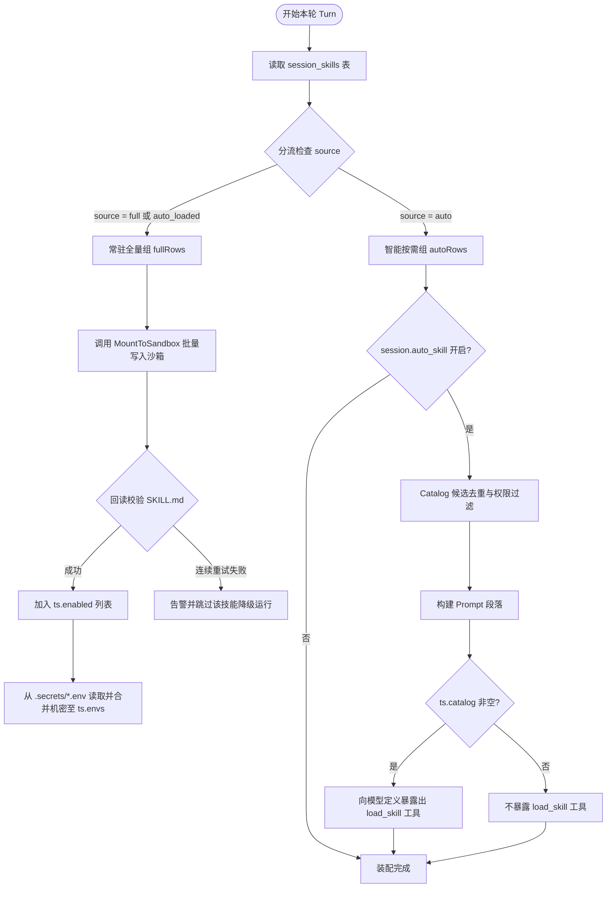
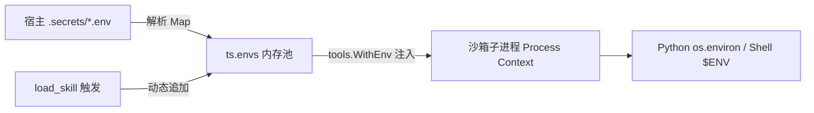

# Skill 运行时装配与沙箱执行规范 (Runtime Specification)

> **版本**：v1.2.0  
> **核心组件**：`backend/pkg/agent/skills.go`、`backend/pkg/skill/store.go`、`backend/pkg/skill/prompt.go`

---

## 1. 运行时状态流转与开轮分流装配 (`loadTurnSkills`)

每一轮对话（Turn）启动时，Agent 引擎都会构建一个瞬态的 `turnSkills` 状态上下文。该过程通过对数据库 `session_skills` 表中的配置进行严格分流装配：



### 1.1 分流过滤规则
1. **去重与互斥保障**：
   - 任何已经在 `ts.enabled`（已全量挂载）中的技能，**绝对不能**重复进入 `ts.catalog`。
2. **机密权限过滤**：
   - 若技能标记为 `confidential = true`，且当前用户非创建者所有者，则该技能禁止进入候选目录。
3. **按需严格匹配原则（无未授权侵入）**：
   - Catalog 候选集严格且仅来自用户在会话中显式配置为 `auto` 的技能记录（`autoRows`）。若会话未配置任何 `auto` 技能（`autoRows` 为空），则 Catalog 保持为空，Prompt 不注入目录段，亦不暴露 `load_skill` 工具。系统绝不越俎代庖将全库未勾选技能推入，充分尊重用户的配置意图。

---

## 2. 沙箱物化机制与防竞态校验 (`MountToSandbox`)

### 2.1 物理挂载布局
技能文件从宿主机根目录（默认 `skills/<dir_name>/`）同步写入会话工作区的 `skills/<dir_name>/` 下。无论底层沙箱驱动为 Local、Docker 还是 E2B，均保持统一的相对路径体系：

```text
/workspace (沙箱工作区根目录)
└── skills/
    ├── web-search/
    │   ├── SKILL.md
    │   └── scripts/search.py
    └── data-visualizer/
        ├── SKILL.md
        └── scripts/draw.py
```

### 2.2 防护上限与资源配额 (Quota Protection)
为防止异常代码、大文件或巨型依赖包击穿沙箱传输信道，系统内置硬性阈值：
- **最大文件数量 (`maxMountFiles`)**：`200` 个文件。超过上限将直接拒绝挂载并告警。
- **最大体积上限 (`maxMountTotalByte`)**：`16 MB`。超过上限将直接拒绝挂载。
- **忽略隐藏文件**：以 `.` 开头的隐藏文件或子目录（如 `.git`、`.idea`）自动跳过。

### 2.3 解决首轮对话挂载竞态：同步回读探活 (Read-back Verification)
在异步容器或本地 IO 存在瞬时延迟的场景下，若文件尚未完全刷盘模型就已收到 Prompt 并执行 `read_file`，会导致首次读取失败。

为从架构上杜绝竞态，`MountToSandbox` 在写完文件后引入**强制同步回读重试循环**：
```go
// 挂载确认与沙箱健康检查：回读 SKILL.md，确保沙箱真正就绪且文件写入已落盘
checkDst := path.Join(MountDir, dirName, "SKILL.md")
verified := false
for attempt := 0; attempt < 3; attempt++ {
    if _, readErr := sandbox.ReadFile(ctx, sessionID, checkDst); readErr == nil {
        verified = true
        break
    }
    time.Sleep(50 * time.Millisecond)
}
if !verified {
    return 0, errors.NewMsg("沙箱挂载校验失败，文件未就绪: " + dirName)
}
```
只有确认 `SKILL.md` 能够正常读出后，该技能才被正式计入 `ts.enabled`。

---

## 3. 提示词装配双轨机制 (Prompt Assembly)

### 3.1 已挂载技能段 (`BuildSkillsPrompt`)
为模型提供确定性的操作指引：
```text
## 可用 Skills（已挂载）

以下技能已完成沙箱工作区挂载并在当前会话直接可用：
每个技能在工作区中的完整路径为 `skills/<目录名>/`。若需要查阅完整使用说明，请使用 `read_file` 读取其入口文件 `skills/<目录名>/SKILL.md`，随后按指引用 bash 或 python_exec 调用其中的脚本。
技能配置的机密密钥已直接注入当前进程环境变量（可直接从 os.environ 读取）。

- **web-search**（web-search/）：进行互联网实时搜索与信息汇总（入口文件：`skills/web-search/SKILL.md`）
```

### 3.2 按需加载目录段 (`BuildCatalogPrompt`)
防止 Token 膨胀，截断描述至 160 个字（`CatalogDescLimit = 160`）：
```text
## Skill 目录（按需加载）

平台里还有下面这些 skill。它们**尚未加载**——工作区里没有它们的文件，你现在看到的只是名字和用途摘要。
当用户的需求明显落在某个 skill 的用途范围内时，先调用 `load_skill(name)`，拿到完整说明后再按说明操作；用途不匹配就正常回答，**不要为了用而用**。

注意：不要用 read_file / bash（ls、find 等）去探测或读取未加载技能的文件——它们不在工作区里，必然扑空；使用未加载技能的唯一入口是 load_skill(name)，它的返回已经包含你需要的全部说明。

- `pdf-parser`：用于解析各类 PDF 格式文档，支持文本提取、表格结构化还原以及 OCR 识别……

判断不了要不要用时，优先直接回答或反问用户，而不是把目录里的 skill 挨个加载一遍。
```

---

## 4. `load_skill` 动态拦截器与状态晋升规范

### 4.1 工具契约 (Tool Definition)
当且仅当 `hasCatalog() == true` 时，向模型下发 `load_skill`：
```json
{
  "type": "function",
  "function": {
    "name": "load_skill",
    "description": "按需装载技能库目录中的某个 skill。成功后会将该技能的文件放入工作区 skills/<dir>/，将其环境变量注入当前环境，并返回其完整使用指引。",
    "parameters": {
      "type": "object",
      "properties": {
        "name": {
          "type": "string",
          "description": "待加载的技能名称，必须严格匹配目录中出现的名称"
        }
      },
      "required": ["name"]
    }
  }
}
```

### 4.2 执行拦截与防御分支
后端在 `runLoadSkill` 中直接拦截该调用（不分派至通用沙箱工具执行器）：

| 命中场景 | 返回内容特征 | 状态机行为 |
| :--- | :--- | :--- |
| **已全量挂载** | `[无需加载] <name> 已在本会话启用...` | 不重复挂载，引导模型直接读工作区文件 |
| **不在目录中** | `[未找到] 目录里没有名为 <name> 的技能...` | 打印当前可加载列表，引导模型不要无端重试 |
| **当轮已装载** | `[已加载] <name> 本轮已经加载过了...` | 避免多重物化 |
| **超当轮阈值** | `[已达上限] 本轮已自动加载 3 个技能...` | 单轮上限 `MaxAutoSkillLoads = 3`，防死循环 |
| **装载成功** | `已加载技能 <name>，文件在工作区...` | **立即物化** -> **合并机密** -> **持久化晋升为 `auto_loaded`** -> **推送 SSE `skill_loaded`** |

### 4.3 SKILL.md 返回长度截断保护
若加载的技能其 `SKILL.md` 正文超过 `8000` 字符（`SkillMDPreviewLimit`），截断前 8000 字符并追加提示：
```text
…（SKILL.md 共 12500 字符，此处截断。需要后面的内容时用 read_file 读 skills/<dir>/SKILL.md）
```

---

## 5. 进程环境变量注入机制 (`tools.WithEnv`)

机密密钥绝不以明文文件形式保存在沙箱工作区，而是仅在调用沙箱执行类工具（如 `bash`、`python_exec`）时，通过进程环境变量传递：



- **注入时机**：由 Agent 编排器在每次执行 `bash` / `python_exec` 时，将当前 `ts.envs` 作为进程附加环境变量传入沙箱驱动。
- **动态就绪**：在同一轮次中，`load_skill` 必定先于后序的脚本执行工具运行。`runLoadSkill` 一旦成功，立即就地修改当前 Turn 的 `ts.envs`，使同轮随后的 `bash` 工具能够立即读取到刚刚装载的 API Key。
