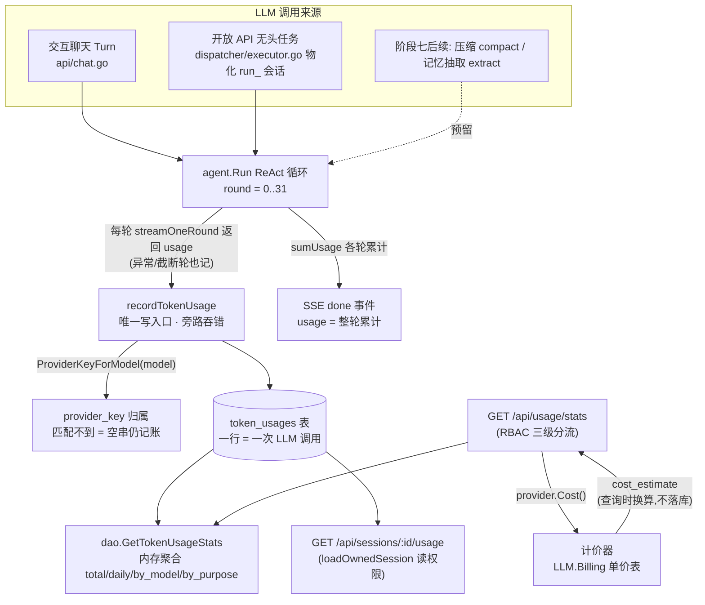

# 阶段七（模块一）：Token Usage 计费审计技术规范 (Token Usage Audit & Billing)

> **版本**：v1.0.0  
> **所属阶段**：系统架构阶段七 (Phase 7) —— 上下文预算、长程记忆与压缩 · 模块一  
> **核心组件**：归一化 Token 审计、旁路记账引擎、计费估算 (Query-time Pricing)、用量统计查询 (RBAC)

---

## 1. 架构总览与设计目标

模块一是阶段七的地基：在任何压缩、记忆策略生效之前，必须先**精确知道每一次 LLM 调用消耗了什么**。本模块对平台上全部 LLM 调用（交互对话 ReAct 循环、开放 API 无头任务、未来的历史压缩与记忆抽取）实施逐调用粒度的 Token 审计，并在查询侧基于单价表完成成本估算。

### 1.1 核心设计目标

1. **一次 LLM 调用一行 (Per-call Granularity)**  
   `token_usages` 表按"一次上游 LLM 调用"记账，而非一次对话或一个 Turn。ReAct 多轮工具循环中每一轮模型推理各自成行（`round_index` 标识轮次），真实暴露"每轮重发历史"的上下文成本结构。

2. **四路 Token 独立度量 (Normalized Audit)**  
   归一化度量输入（`prompt_tokens`）、输出（`completion_tokens`）、缓存命中（`cached_tokens`）与推理链（`reasoning_tokens`）。语义严格对齐 OpenAI 规范：**cached ⊂ prompt_tokens、reasoning ⊂ completion_tokens**（子集关系，杜绝双计）。

3. **记账是旁路，绝不打断对话 (Bypass Recording)**  
   记账失败只记 `slog.Warn` 日志，任何情况下不影响对话流；上游未返回 usage 不写空行；使用 `context.WithoutCancel` 保证客户端中止/断连后账务仍落库。

4. **异常轮次也烧了 Token (Aborted Rounds Bill Too)**  
   埋点位于每轮流式返回之后、异常分支判断之前——模型中途报错、输出被截断、用户取消的轮次，已消耗的部分照常记账，不漏账。

5. **单价不落库，查询时换算 (Query-time Pricing)**  
   数据库只存 token 计数；单价表放 `etc/config.yaml` 的 `LLM.Billing` 段，统计接口查询时现算金额。**调价不回改历史账单**，金额字段统一命名 `cost_estimate`（估算值，非账单）。

6. **全链路自动归因 (Attribution by Construction)**  
   每行冗余存储 `session_id / company_id / user_id / model / provider_key`，行自解释；开放 API 无头任务经物化会话自动继承调用方归属，`session_id` 可 join 回 `skill_runs.run_id`；一处埋点同时覆盖交互聊天与开放 API 两条链路。

7. **账务生命周期独立 (Audit Outlives Business Data)**  
   `token_usages` 故意**不建外键**：会话删除后用量记录保留（账务数据不得随业务数据消失），`DeleteSession` 级联清理不触及本表。

8. **为阶段七后续模块预留 (Forward Compatibility)**  
   `purpose` 枚举预留 `compact`（历史压缩摘要）与 `extract`（记忆抽取）：阶段七模块二、三落地时复用同一记账入口，仅换 purpose 值，审计口径全程一致。

---

## 2. 总体数据流拓扑

---

## 3. 关键机制速览

| 机制 | 规范文档 | 一句话说明 |
| :--- | :--- | :--- |
| 表结构与字段语义 | [database.md](./database.md) | `token_usages` DDL、子集语义、purpose 枚举、索引与"不建外键"原则 |
| 记账引擎与计价 | [billing.md](./billing.md) | 唯一写入口契约、旁路铁律、逐轮记账时序、`ProviderKeyForModel`、单价配置与换算公式 |
| 统计查询接口 | [api.md](./api.md) | `GET /api/usage/stats` 与 `GET /api/sessions/:id/usage` 契约、RBAC 可见性矩阵、`cost_estimate` 语义 |

---

## 4. 文档导航与索引

详细设计与实现细节已拆分为以下各专属技术规范文档，请参阅：

- [数据模型与数据库字段规范 (database.md)](./database.md)  
  包含 `token_usages` 的完整建表 DDL、字段类型约束、索引设计、四路 Token 子集语义与 purpose 状态枚举。
- [记账引擎与计费规范 (billing.md)](./billing.md)  
  包含旁路记账引擎契约、ReAct 循环逐轮记账时序、provider_key 归属算法、`LLM.Billing` 单价配置与查询时换算公式。
- [接口契约与 API 规范 (api.md)](./api.md)  
  包含用量统计端点（`/api/usage/stats`）与会话级用量端点（`/api/sessions/:id/usage`）的定义、三级 RBAC 可见性矩阵与响应结构。
