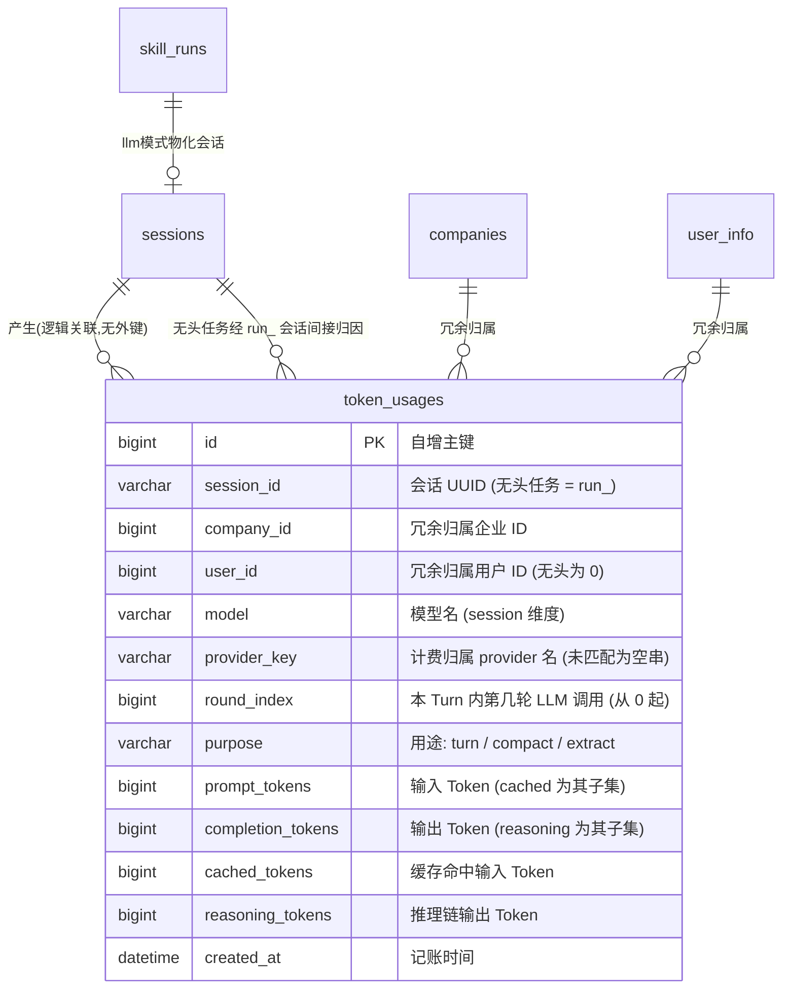

# Token Usage 数据库模型规范 (Database Specification)

> **版本**：v1.0.0  
> **数据库引擎**：MySQL 8.0+ / InnoDB / `utf8mb4`  
> **ORM 映射**：GORM Gen ([`backend/dal/model/`](../../backend/dal/model/))  
> **实体定义**：[`token_usages.gen.go`](../../backend/dal/model/token_usages.gen.go)、强类型查询 [`token_usages.gen.go`](../../backend/dal/query/token_usages.gen.go)  
> **DDL 唯一源头**：[`deploy/sql/schema.sql`](../../deploy/sql/schema.sql)（DB-first，本表随阶段六脚手架预置，本模块零 DDL 变更）

---

## 1. 实体关系总览 (Entity Relationship)



> **设计原则：故意不建外键。** 用量记录是账务数据，会话被删除之后仍要保留；`company_id` / `user_id` / `model` / `provider_key` 在每行冗余存储，让每条账目自解释，不依赖 join 才能读懂。

---

## 2. 表结构详细定义

### 2.1 用量记录表 `token_usages`

#### DDL 结构

```sql
CREATE TABLE `token_usages` (
  `id` BIGINT NOT NULL AUTO_INCREMENT COMMENT '记账主键 ID',
  `session_id` VARCHAR(36) COLLATE utf8mb4_unicode_ci NOT NULL COMMENT '会话 UUID (开放API无头任务为 run_<run_id>)',
  `company_id` BIGINT NOT NULL DEFAULT '0' COMMENT '冗余归属企业 ID',
  `user_id` BIGINT NOT NULL DEFAULT '0' COMMENT '冗余归属用户 ID (无头任务为 0)',
  `model` VARCHAR(128) COLLATE utf8mb4_unicode_ci NOT NULL COMMENT '模型名',
  `provider_key` VARCHAR(64) COLLATE utf8mb4_unicode_ci NOT NULL DEFAULT '' COMMENT '计费归属 provider 名 (未匹配为空串)',
  `round_index` BIGINT NOT NULL DEFAULT '0' COMMENT '本 Turn 内第几轮 LLM 调用 (从 0 起, 纯排序键)',
  `purpose` VARCHAR(16) COLLATE utf8mb4_unicode_ci NOT NULL DEFAULT 'turn' COMMENT '用途: turn 对话推理 / compact 历史压缩 / extract 记忆抽取',
  `prompt_tokens` BIGINT NOT NULL DEFAULT '0' COMMENT '输入 Token (cached_tokens 为其子集)',
  `completion_tokens` BIGINT NOT NULL DEFAULT '0' COMMENT '输出 Token (reasoning_tokens 为其子集)',
  `cached_tokens` BIGINT NOT NULL DEFAULT '0' COMMENT '缓存命中输入 Token (含在 prompt_tokens 内)',
  `reasoning_tokens` BIGINT NOT NULL DEFAULT '0' COMMENT '推理链输出 Token (含在 completion_tokens 内)',
  `created_at` DATETIME(3) NOT NULL DEFAULT CURRENT_TIMESTAMP(3) COMMENT '记账时间',
  PRIMARY KEY (`id`),
  KEY `idx_token_usages_model` (`model`),
  KEY `idx_token_usages_purpose` (`purpose`),
  KEY `idx_token_usages_created_at` (`created_at`),
  KEY `idx_token_usages_session_id` (`session_id`),
  KEY `idx_token_usages_company_id` (`company_id`),
  KEY `idx_token_usages_user_id` (`user_id`)
) ENGINE=InnoDB DEFAULT CHARSET=utf8mb4 COLLATE=utf8mb4_unicode_ci COMMENT='LLM 调用 Token 用量审计表';
```

#### 字段语义要点

- **一行 = 一次上游 LLM 调用**。ReAct 多轮工具循环里每轮模型推理各记一行，`round_index` 从 0 递增，纯排序键；第二轮的 `prompt_tokens` 天然大于第一轮（每轮重发全部历史），这是成本分析的核心观测点。
- **子集语义（防双计）**：`cached_tokens ⊆ prompt_tokens`、`reasoning_tokens ⊆ completion_tokens`（OpenAI 规范语义）。计价时未命中缓存的输入 = `prompt_tokens - cached_tokens`，不得把 cached 再加一遍。
- **`provider_key`（分账归属）**：模型经 `ProviderKeyForModel` 解析出的 provider 名（如 `minimax`、`glm`）。已下线/未注册模型匹配不到时记空串，**仍记账**——账不能因模型下线而丢。
- **`session_id` 的双重语义**：交互聊天为会话 UUID；开放 API 无头任务为物化会话 `run_<run_id>`，可直接 join 回 `skill_runs.run_id` 完成开放 API 计费归因。
- **归属冗余**：`company_id` / `user_id` 从 Session 冗余携带（无头任务由调度器在物化会话时写入调用方归属），统计接口按此直接分流，无需 join。
- **金额不入库**：本表没有任何金额字段。单价配置在 `etc/config.yaml` 的 `LLM.Billing`，查询时换算（见 [billing.md](./billing.md)）——调价不回改历史数据。

#### 索引设计

| 索引 | 服务场景 |
| :--- | :--- |
| `idx_token_usages_created_at` | 统计接口的时间窗过滤（`days` 参数） |
| `idx_token_usages_company_id` / `idx_token_usages_user_id` | RBAC 三级分流的 WHERE 条件 |
| `idx_token_usages_session_id` | 会话级用量明细查询 |
| `idx_token_usages_model` / `idx_token_usages_purpose` | by_model / by_purpose 聚合维度过滤 |

---

## 3. purpose 用途枚举

| 取值 | 常量 (`constants`) | 写入时机 | 状态 |
| :--- | :--- | :--- | :--- |
| `turn` | `UsagePurposeTurn` | ReAct 循环每轮流式返回后（含异常/截断/取消轮次）；交互聊天与开放 API 无头任务共用 | **本期启用** |
| `compact` | `UsagePurposeCompact` | 历史压缩流水线生成 `SessionDigest` 摘要的 LLM 调用后 | 预留（阶段七模块二） |
| `extract` | `UsagePurposeExtract` | 长期记忆后台抽取的 LLM 调用后 | 预留（阶段七模块三） |

三类 purpose 复用同一记账入口 `recordTokenUsage`（见 [billing.md](./billing.md)），审计口径全程一致；预留值不产生任何本期写入点。

---

## 4. 数据生命周期

- **不随会话删除**：`DeleteSession` 级联清理 messages / 附件 / 沙箱工作区，但**显式不级联 `token_usages`**——审计/账务数据生命周期独立于业务数据。
- **只增不改**：本表为 append-only 账务流水，业务代码不 UPDATE / DELETE 历史行。
- **无软删除**：账务数据不支持逻辑删除，运维清理走 DBA 手工归档流程。
